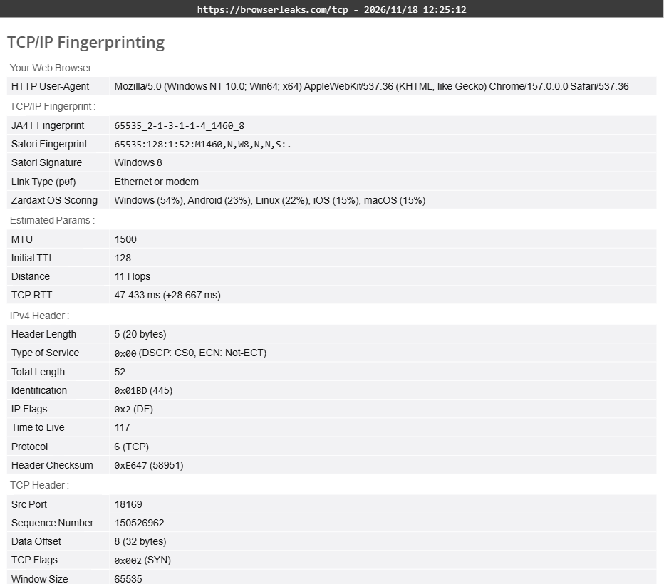

# Как антифрод детектит прокси

**Разбор сетевых и браузерных признаков, по которым риск-движки отличают прокси от живого пользователя.** С реальными скриншотами BrowserLeaks, двумя стендами (эталонным и провальным) и честными границами применимости.

Сначала — что делать и как выбрать exit. Потом — почему это работает: TTL, p0f/JA4T, MSS, RTT, TLS/HTTP2, QUIC, WebRTC, Client Hints, IPv6. В конце — где антифрод ошибается, чего не хватает в этой картине и почему «чистый IP» ничего не гарантирует.

---

## Главное в пяти строках

1. Прокси не «прячет» IP. Он разрезает одно TCP-соединение на два и подставляет на выходе чужую машину — со своим ядром, своим TTL и своим RTT.
2. Антифрод не ищет «прокси». Он ищет **противоречие** между тем, кем притворяется браузер, и тем, как ведёт себя сеть.
3. Жёсткие сигналы: WebRTC-утечка, DNS-расхождение, открытый прокси-порт, MITM-сертификат, OS ≠ UA. Мягкие: ASN-теги, MSS, RTT, джиттер, нестандартное окно.
4. Один сигнал — шум. Три независимых из разных слоёв — приговор. Поэтому «чистый residential IP» сам по себе ничего не гарантирует.
5. Самый надёжный анти-детект — не подделка стека, а **exit, у которого стек уже нужный**. Всё остальное — компромисс между правдоподобием и стабильностью.

---

## Два стенда: эталон и антипример

Все скриншоты в разборе — из двух прогонов, а не «из интернета». Это важно: на одном видно, как слои сходятся, на другом — как они расходятся.

*Эталон: реальная Windows 11, Chrome 157, Starlink (AS14593). `Initial TTL 128`, окно `65535`, `WS 8`, JA4T `65535_2-1-3-1-1-4_1460_8`; Satori — Windows 8, Zardaxt — Windows 54%.*

<table>
<tr><td><b>Параметр</b></td><td><b>Эталон</b></td><td><b>Антипример</b></td></tr>
<tr><td>Клиент</td><td>Windows 11, Chrome 157</td><td>Linux, Chromium 157 headless, UA override на Windows</td></tr>
<tr><td>Exit</td><td>Starlink, AS14593, США</td><td>G-Core Labs, AS199524, Токио (VPN/CDN/VPSH/TOR)</td></tr>
<tr><td>TTL / distance</td><td><code>128</code> / 11 хопов</td><td><code>64</code> / 19 хопов</td></tr>
<tr><td>Окно / WScale</td><td><code>65535</code> / 8</td><td><code>42340</code> / 11</td></tr>
<tr><td>Satori / Zardaxt</td><td>Windows 8 / Windows 54%</td><td><code>no matches</code> / Android 54%, Linux 45%</td></tr>
<tr><td>IPv6 / WebRTC</td><td>есть, public IP = HTTP IP</td><td>нет (<code>n/a</code>), No Leak</td></tr>
</table>

*Антипример целиком — в [§11. Стенд](docs/4-checks/11-stands.md) и в [screenshots/bad](screenshots/bad/). IP-адреса, hostname, города и координаты на снимках замазаны.*

---

## Структура

Разбор разбит на пять частей. README — только вход; всё остальное — в `docs/`.

| Часть | Что внутри | Разделы |
|---|---|---|
| **[Практика](docs/1-practice/README.md)** | Что брать под профиль, как выбрать провайдера и шлюз, что проверять за 10 минут | [Готовое решение](docs/1-practice/ready-solution.md) · [Провайдеры и шлюзы](docs/1-practice/providers-and-gateways.md) |
| **[Сеть](docs/2-network/README.md)** | IP/ASN, TTL, p0f/JA4T, MSS/MTU, RTT, скорость — и почему всё это свойства exit, а не пользователя | §0–§6 |
| **[Браузер](docs/3-browser/README.md)** | BrowserLeaks как рентген: WebRTC, DNS, TLS, HTTP/2, Client Hints; как сигналы складываются в скор и где он ошибается | §7–§9 |
| **[Проверка](docs/4-checks/README.md)** | Чек-лист, два стенда с числами, границы метода и подгонка стека | §10–§13 |
| **[Пробелы](docs/5-gaps/README.md)** | IPv6/dual-stack, HTTP/3 и QUIC, headless-артефакты вне сети — то, что обычно выпадает из таких разборов | §14–§16 |

Полное оглавление с описаниями — в [docs/README.md](docs/README.md). Источники — в [docs/references.md](docs/references.md).

---

## Что в этом разборе сделано иначе

- **Два стенда вместо одного.** Эталонный прогон показывает, как выглядит согласованная конфигурация; провальный — как выглядит расхождение. Один и тот же браузер, разный стек и разный exit.
- **Скриншоты читаются, а не листаются.** Под каждым — что именно смотреть и почему это важно; в §11 сведены все параметры обоих прогонов в одну таблицу.
- **Числа с оговорками и источниками.** Где значение зависит от ядра, NAT, железа или версии Windows — это сказано прямо. Где источник — эмпирическое наблюдение, а не спецификация, — тоже.
- **Честные границы.** Сеть — тонкий слой: за CDN её видит только CDN, JS-скоринг её не видит вообще, а «no matches» — это возраст базы подписей, а не приговор.
- **Новые слои.** IPv6/dual-stack утечки, HTTP/3-фингерпринт и headless-артефакты — три вещи, без которых картина в 2026-м неполная.

---

## Границы и дисклеймер

> [!WARNING]
> Это разбор **механики детекта**, а не инструкция по обходу закона. Всё описанное — пассивные признаки, которые видит любой сервер. Ни один отдельный признак не является доказательством: антифрод ошибается на VPN, CGNAT, спутниковом интернете и корпоративных прокси (§9). И наоборот: согласованный стек не гарантирует, что вас не вычислят по поведению, аккаунту или репутации IP.

> [!CAUTION]
> **Про «резидентские» пулы.** Реверс-прокси на чужих устройствах (SDK, расширения, «бесплатные VPN», торрент-клиенты) — это использование чужого канала без информированного согласия владельца. Это нестабильно по аптайму, рискованно юридически (в США — 18 U.S.C. §1030, в Великобритании — Computer Misuse Act 1990, в ЕС — GDPR), нарушает ToS приложений и этически не отличается от ботнета, просто аккуратнее упаковано. Для легального продукта берите свои Windows-хосты или пулы с явным согласием и договором. Подробнее — в [«Провайдеры и шлюзы»](docs/1-practice/providers-and-gateways.md).

---

## Лицензия и скриншоты

Текст и схемы — [CC BY 4.0](LICENSE): можно использовать с указанием авторства и ссылкой на репозиторий. Скриншоты — BrowserLeaks © 2011–2026, приведены как иллюстрация к разбору; все чувствительные поля замазаны. Если вы используете фрагменты — сохраняйте подпись и ссылку на первоисточник.

Репозиторий: [god4claw/how-proxy-detection-works](https://github.com/god4claw/how-proxy-detection-works) · Вопросы и правки — через issue или PR.
