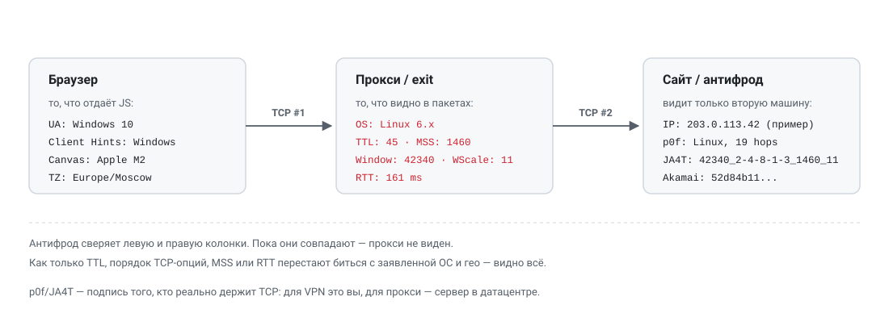
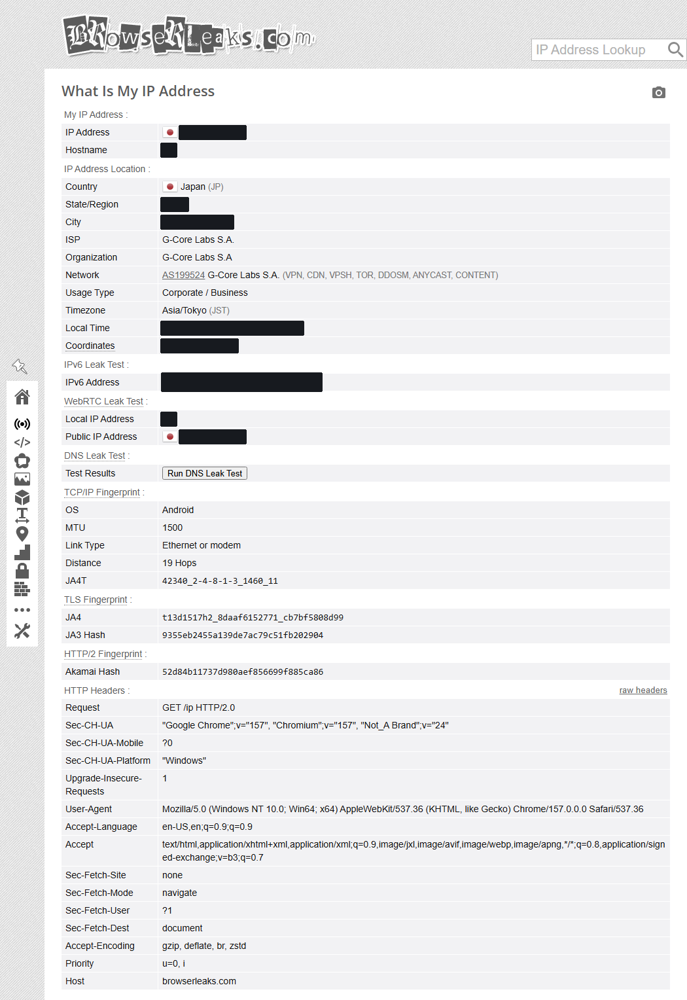
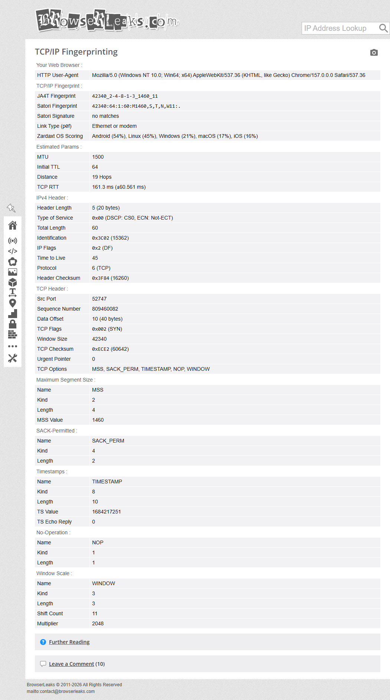
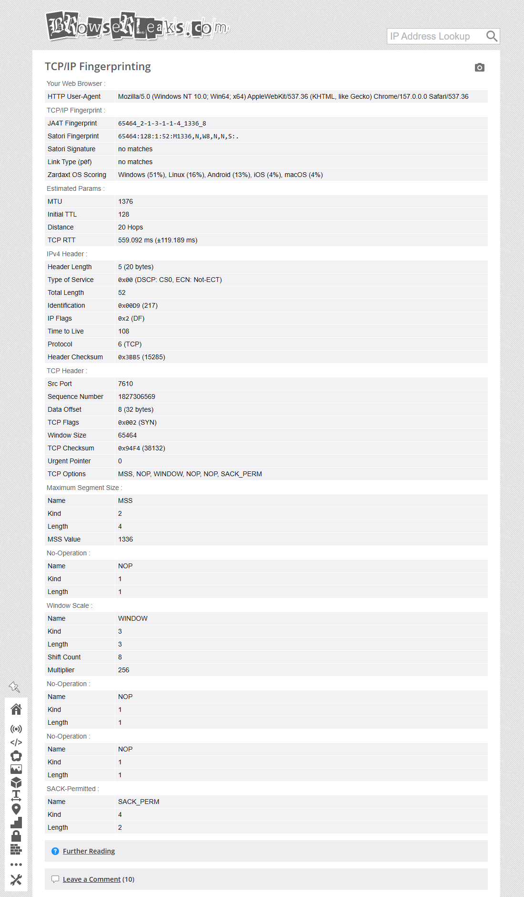
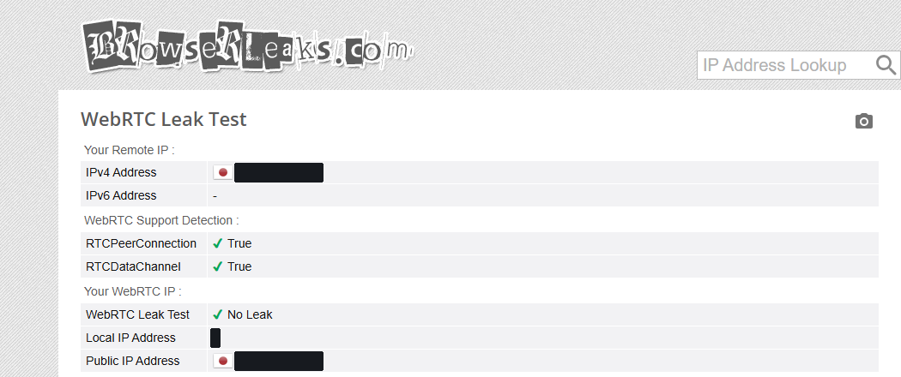
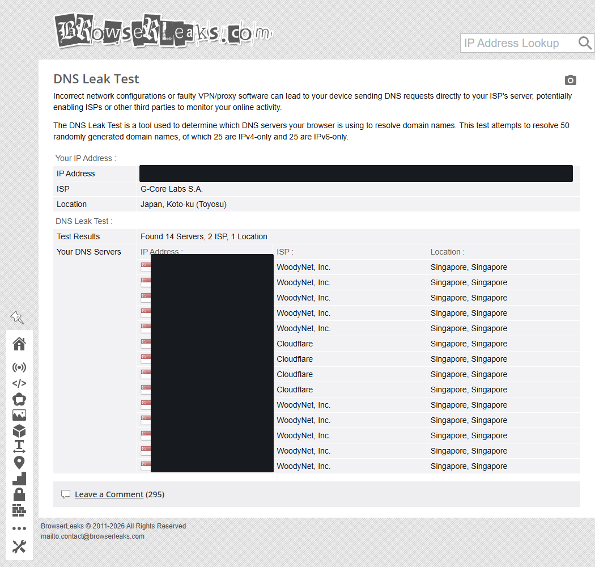
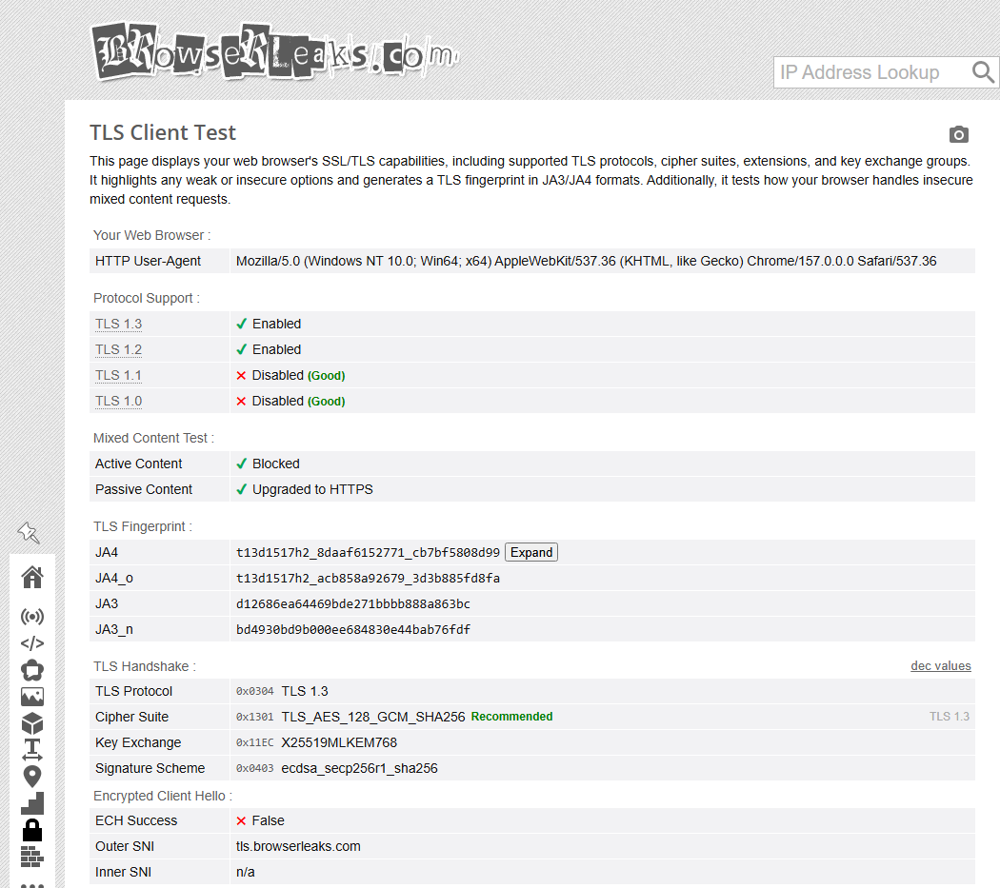
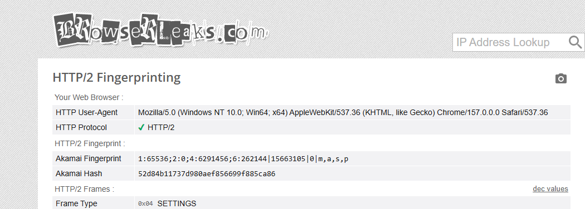

# Как антифрод детектит прокси

### TTL · p0f / JA4T · MSS · RTT · скорость · BrowserLeaks · выбор пула

> Разбор сетевых и браузерных признаков, по которым риск-движки отличают прокси от живого пользователя. С реальными скриншотами BrowserLeaks и разбором того, что на них смотреть. Сначала — готовое решение и выбор провайдера, дальше — механика.

---



*Схема условная; значения соответствуют прогону со скриншотов ниже (Linux-прокси, MSS 1460). Вариант с выходом за WireGuard/AmneziaWG — в разделе 4.*

## Коротко

1. Прокси не «прячет» IP. Он разрезает одно TCP-соединение на два и подставляет на выходе чужую машину — со своим ядром, своим TTL и своим RTT.
2. Антифрод не ищет «прокси». Он ищет противоречия между тем, кем притворяется браузер, и тем, как ведёт себя сеть.
3. Жёсткие сигналы: WebRTC-утечка, DNS-утечка, открытый прокси-порт на IP, TTL/p0f не той ОС, RTT, невозможный для геолокации.
4. Мягкие: урезанный MSS (туннель), джиттер, странная скорость, ASN-теги хостинга, PTR.
5. Один сигнал — шум. Три независимых — приговор. Поэтому «чистый residential IP» сам по себе ничего не гарантирует.

> **Стенд:** Chromium 157 (headless) на Linux-хосте, одиночный exit `G-Core Labs` в Токио, UA/Client Hints → Windows 10. Стек exit: MSS 1460, окно 42340, WS 11, TTL 45 при initial 64 (19 хопов), RTT 161 ms. Полная таблица, оговорки и границы применимости — §11.

## Готовое решение: что брать под профиль

Если читать одну секцию — эту. Всё остальное в статье объясняет **почему** так, но решение принимается здесь.

Профиль ломают три несовпадения, и все три решаются выбором exit, а не подделкой:

1. **ОС.** Профиль Windows, а TCP держит Linux-релей: `TTL 64` вместо `128`, другой порядок опций, другой MSS. User-Agent это не прикрывает — см. §3.
2. **География.** Ты, шлюз продавца и exit — три разные точки. С профилем должна совпадать последняя, а не «страна в тарифе».
3. **Качество.** Нет UDP, рвётся сессия, скачет скорость — профиль живёт минуты, и это видно по поведению, а не по IP.

### Что брать

| Профиль | Какой exit нужен | Что должно быть в `/tcp` | Чем платишь |
|---|---|---|---|
| Windows 10/11 | Windows-хост: свой Windows VPS или резидентский пул с реальных Windows-машин | `Initial TTL 128`, окно `65464–65535`, `WS 8`, опции `MSS, NOP, WS, NOP, NOP, SACK` | VPS → ASN хостинга в `/ip`; резидентка → скорость и аптайм |
| Linux / Android | Linux-хост, лучше мобильный | `Initial TTL 64`, окно `29200–65483`, `WS 7` | мобильный пул дорогой и медленный |
| macOS / iOS | macOS-хост (пулов мало) | окно `65535`, `WS 6` | цена и выбор |
| «Мобильный» | мобильный пул 4G/LTE, а не датацентр с мобильным UA | MSS часто ниже 1460, RTT и джиттер как у сотовой сети | цена за гигабайт |

Правило, которое важнее таблицы: **для Windows-профиля нужен Windows-exit, а не «чистый IP».** Резидентский прокси, у которого TCP держит реальная Windows-машина, — это и есть готовое решение: стек уже нужный, подделывать нечего. Linux-релей в датацентре с `TTL 64` не исправить ни UA, ни Client Hints.

### Порядок выбора

1. ОС профиля → тип exit (таблица выше).
2. Твой регион и регион цели → где должен стоять шлюз (следующая секция).
3. UDP: нужен, если в профиле живут WebRTC, QUIC или видео. Проверять, а не верить тарифу.
4. Липкость: один exit на сессию, без ротации по умолчанию.
5. Репутация: IP, PTR, блоклисты — дешёвая проверка, которая отсекает половину пула.

---

## Провайдеры и шлюзы: почему «чистый IP» не спасает

### Откуда берутся «резидентские» IP

| Тип пула | Что это | Плюсы | Минусы | Как выглядит в тестах |
|---|---|---|---|---|
| Микс-пул (агрегатор) | перепродажа чужих пулов | дёшево, много стран | состав — лотерея, часть IP уже сгорела, UDP часто нет | `/tcp` чистый, но репутация плохая и скорость скачет |
| Реверс-прокси на устройствах | приложение, SDK, расширение или торрент-клиент на чужой машине: владелец ставит «бесплатный VPN», а его сеть используют | настоящий ISP и настоящий стек | аптайм как повезёт, чужой канал, согласия владельца нет | стек честный, но exit пропадает и скорость плавает |
| Ботнет | те же устройства, но заражённые | дёшево, «жилые» ASN | IP в блоклистах (XBL/abuse), живут часы, релею нельзя доверять | IP «грязный», профиль умирает за день |
| Свои блоки провайдера | купленные адреса в ISP или датацентре | стабильно, быстро, UDP есть | это не резидентка: ASN-теги в `/ip` выдают | `VPSH`/`VPN`, usage `Corporate` |

Вывод: «резидентский IP» — это не свойство адреса, а свойство **устройства на другом конце**. Один и тот же ASN может отдавать и живой Windows-ноутбук, и заражённый сервер, и Linux-релей, который притворяется первым.

### Шлюз — третья точка, о которой не думают

Типичная схема: **браузер → шлюз продавца → exit → сайт**. Шлюз — точка, где продавец собирает коннекты клиентов и распределяет их по exit-хостам; часто она одна на весь мир или одна на регион.

- **Сайт видит только exit.** Поэтому `TCP RTT` в `/tcp` — это RTT exit ↔ сайт. Он может быть прекрасным, даже если у тебя всё ползёт.
- **Задержку и скорость чувствуешь ты.** Ты в Азии, шлюз в Европе, exit в США, сайт в США: последнее плечо идеальное, а каждый запрос ходит через два континента. Профиль выходит медленным и рваным.
- **Рваный профиль — тоже сигнал.** Скорость не бьётся с профилем, джиттер не как у домашнего канала, ретраи (§5, §6). Шлюз антифрод не видит, а его последствия — видит.
- **Проверка:** сравни `TCP RTT` из `/tcp` с RTT, который ты видишь до того же сайта. Если твой RTT заметно больше, лишний хоп — шлюз. У хорошего провайдера шлюз стоит в твоём регионе или его нет вовсе (прямой коннект к устройству).

Отсюда правило: **шлюз — в твоём регионе, exit — в регионе профиля.** Провайдер с единственным шлюзом в Европе будет медленным для азиатского профиля, каким бы чистым ни был пул.

### Бэкенд: что должно быть настроено

Провайдер — это не только IP, это софт. Минимум, без которого профиль не живёт:

- **UDP relay.** Есть у части провайдеров, у части нет — и «есть» надо проверять, а не читать в тарифе. Без UDP расходятся `/webrtc` и `/quic` (§7), а «QUIC есть, а UDP через прокси не ходит» — сам по себе признак.
- **Sticky sessions.** Один exit на сессию. Ротация «на каждый запрос» рвёт подпись в середине сессии (§2, §13).
- **Таргетинг по городу и ASN.** Для «домашнего» профиля город должен быть правдоподобным, а не «столица, где стоит датацентр».
- **Health-check.** Мёртвые exit'ы не должны выдаваться: иначе половина прогонов — таймауты и «нестабильный прокси».
- **Лимиты на exit.** Если соседи по пулу выжирают канал, у профиля падает скорость — и это тоже читается.

Симптомы бэкенда, который не закрыт: «UDP в тарифе есть, STUN не проходит», «сессия рвётся на третьем запросе», «скорость плавает в десять раз», «exit меняется на каждом запросе», «половина пула не отвечает».

### Проверка провайдера за 10 минут

1. **Подпись стабильна.** Один exit, три прогона `/tcp` с паузой 5–10 минут. `TTL`, `JA4T` и окно не поплыли — годится.
2. **UDP живой.** `/webrtc` — `No Leak`, `/quic` — соединение есть. Если нет, профиль с WebRTC или видео на этом пуле не построить.
3. **Задержка честная.** Сравни `TCP RTT` из `/tcp` со своим RTT до того же сайта — разница и есть твой шлюз.
4. **Скорость.** Скачай 50–100 МБ и сравни с тем, что обещает тариф; смотри на джиттер, а не только на пик.
5. **Репутация.** IP → блоклисты и `PTR`; «резидентка» с PTR хостинга — это датацентр.
6. **Липкость.** 20–30 минут запросов подряд: `exit` и `JA4T` меняются — провайдер не годится для профилей.

Прошёл проверки — дальше только цена. Не прошёл — никакая подгонка `sysctl` не поможет: битый шлюз и бэкенд ломают профиль раньше, чем TTL.

Дальше — механика: почему всё это так устроено (§0–§10), стенд (§11), пропорция (§12) и подгонка стека под профиль (§13).

---

## 0. Две реальности, которые антифрод сравнивает

Прокси — это не «транспорт». Это два независимых TCP-сегмента: браузер → прокси и прокси → сайт. Сайт видит только второй и всё, что можно измерить на сетевом уровне — initial TTL, MSS, размер окна, порядок TCP-опций, IP ID, RTT, джиттер, скорость — это характеристики **exit-машины**, а не пользователя.

Всё, что приходит на уровне приложения — User-Agent, Client Hints, Canvas, WebGL, шрифты — принадлежит браузеру. Антифрод сверяет эти две картинки. Пока они сходятся — прокси невидим. Как только расходятся — видно всё.

Ключевая разница между типами прокси, которую часто путают:

| Схема | Кто держит TCP #2 | Чья p0f-подпись | Что выдаёт |
|---|---|---|---|
| HTTP/HTTPS-прокси, SOCKS5 | прокси-сервер | **сервера** (обычно Linux) | TTL/p0f не совпадает с UA |
| VPN / туннель (WireGuard, OpenVPN) | ваш роутер/ОС | **ваша** | TTL −1, урезанный MSS, нестандартный MTU |
| MITM-прокси (Burp, mitmproxy, антивирус) | прокси-сервер | сервера | свой TLS-сертификат, JA3/JA4 не как у Chrome |

Отсюда первый вывод: **p0f-подпись — это подпись того, кто реально держит TCP.** Для VPN это вы, для прокси — сервер в датацентре.

---

## 1. IP и ASN: уровень 0, дешёвый и шумный

Самое первое, что смотрит любой риск-движок — не пакеты, а метаданные IP. Это дёшево, быстро и даёт априорную вероятность.

- **Тип ASN.** BrowserLeaks на `/ip` прямо рисует теги сети: `VPN Host`, `CDN`, `Server Hosting (VPSH)`, `TOR`, `DDoS Mitigation`, `Anycast`, `Content`. Это ровно тот датасет, который в продакшене покупают у ipinfo, IPQualityScore, MaxMind (Anonymous IP) или Spur — их публичные доки в конце статьи.
- **Usage Type.** `Corporate / Business`, `ISP / Residential`, `Cellular` — разница между «домашний абонент» и «серверная стойка».
- **PTR-запись.** `dsl-…`, `static.…pppoe…` — жилой провайдер; `hosted-by-…`, `vps-…` — хостинг. Обратный DNS врёт редко.
- **Списки.** Spamhaus PBL/XBL, Tor exit-листы, публичные списки открытых прокси, сканы IPv4 на порты 1080/3128/8080/8118, honeypot-сети вроде Spur, которые специально принимают прокси-трафик и помечают узлы.
- **Геолокация + время.** Город, часовой пояс, локальное время. Если IP «в Токио», а браузер живёт в `Europe/Moscow` — это несоответствие, которое стоит в одном ряду с прокси.



*Смотрите на строку `Network`: `AS199524 G-Core Labs (VPN, CDN, VPSH, TOR, DDOSM, ANYCAST, CONTENT)` — семь флагов хостинга в одной строке. И на `OS: Android` при `User-Agent: Windows 10` ниже — это уже расхождение, о котором раздел 3.*

Важно: это **не доказательство**, а prior. Датацентр — подозрение по умолчанию. Residential — «пока чистый, но докажи». Поэтому дальше идут пакеты.

---

## 2. TTL: арифметика, которая ломает легенду

TTL — счётчик хопов. Каждый маршрутизатор уменьшает его на 1. Начальное значение задаёт ОС:

| ОС / устройство | Initial TTL |
|---|---|
| Linux, Android, macOS, iOS, FreeBSD, OpenBSD | 64 |
| Windows (все версии) | 128 |
| Solaris, AIX, сетевое оборудование (Cisco и т.п.) | 255 |

```
hops = initial_ttl − observed_ttl
```

BrowserLeaks на `/tcp` так и делает: показывает `Initial TTL`, `Time to Live` и `Distance`. В живом прогоне с этих скриншотов: `TTL 45`, `initial 64`, `distance 19 hops` — Linux, 19 хопов. Сходится.

Теперь представь, что UA говорит «Windows 11». У Windows initial TTL = 128. Наблюдаемый TTL = 45. Тогда hops = 128 − 45 = **83 хопа**. В интернете максимум ~30, дальше пакет не доедет. Значит, либо TTL подделан, либо это не Windows. Оба варианта — сигнал.

Есть и вторая, более тонкая проверка — **консистентность дистанции**. Прокси-софт умеет переписывать TTL, чтобы «стать похожим» на Windows (`iptables -j TTL --ttl-set 128`). Но тогда `distance` становится 0–2 хопа. До жилого абонента в другом городе не бывает 0 хопов. И MSS, окно и порядок опций всё равно остаются серверными — подделка TTL чинит один симптом из пяти.

Что ещё даёт TTL:

- **Смена TTL в середине сессии** → маршрут или exit-нода поменялись (ротация пула). Жилой абонент так себя не ведёт.
- **TTL, одинаковый у «разных» клиентов** → они выходят через один и тот же узел.
- **VPN-артефакт:** WireGuard по умолчанию декрементит TTL на 1, OpenVPN — в зависимости от конфига. Initial остаётся клиентским, но observed сдвинут.

Ограничение: TTL — грубый сигнал. Балансировщики, NAT и некоторые прокси перезаписывают его целиком. Поэтому TTL никогда не используют в одиночку — его доедают p0f и JA4T.

---

## 3. p0f и «схожесть»: подпись TCP-стека

p0f (и его современные родственники — Satori, Zardaxt, JA4T) — это пассивный фингерпринт по первому пакету, SYN. Он не требует ни JS, ни активных проб: сервер просто читает то, что ему прислали.

| Параметр | Что говорит |
|---|---|
| Initial TTL | семейство ОС (64/128/255) |
| Window size | версия ядра/стек |
| MSS | MTU пути, наличие туннеля |
| Window scale | версия стека |
| **Набор и порядок TCP-опций** | самый дискриминирующий признак |
| DF-бит | поколение стека |
| IP ID | поведение ядра (0 / инкремент / рандом) |
| TCP timestamps | включены/выключены, а также skew часов |

Порядок опций — это отпечаток пальца, потому что каждая ОС собирает список опций в своём порядке:

| ОС (ориентир) | TTL | Window | WScale | MSS | Порядок опций |
|---|---|---|---|---|---|
| Linux 4.x–6.x | 64 | 29200–65435 | 7 | 1460 | MSS, SACK, TS, NOP, WS |
| Windows 10/11 | 128 | 65535 (реже 8192) | 8 | 1460 | MSS, NOP, WS, NOP, NOP, SACK |
| macOS / iOS | 64 | 65535 | 6 | 1460 | MSS, NOP, WS, NOP, NOP, TS, SACK |
| FreeBSD | 64 | 65535 | 6 | 1460 | MSS, NOP, WS, NOP, NOP, TS, SACK |
| Android | 64 | 29200–65483 | 7 | 1460 | MSS, SACK, TS, NOP, WS |

Значения зависят от версии ядра и sysctl — это ориентир, а не константа. Именно поэтому p0f и Zardaxt выдают не «ответ», а вероятности.



*Здесь всё сразу: `JA4T 42340_2-4-8-1-3_1460_11`, `Satori 42340:64:1:60:M1460,S,T,N,W11:.`, `Satori Signature: no matches` (неизвестная сборка — сам по себе флаг) и `Zardaxt: Android 54%, Linux 45%, Windows 21%`. При этом `User-Agent` вверху — Windows. Это и есть p0f-UA mismatch в чистом виде.*

Расшифровка JA4T: `<window>_<опции>_<MSS>_<wscale>`, где опции — это номера видов: 2 = MSS, 4 = SACK, 8 = TIMESTAMP, 1 = NOP, 3 = WINDOW. То есть `2-4-8-1-3` = `MSS, SACK, TS, NOP, WS` — ровно Linux.

**Почему это ломает прокси.** HTTP-прокси и SOCKS5 терминируют TCP и открывают новое соединение от себя. Значит, сайт видит SYN от прокси-сервера — обычно Ubuntu/Debian в датацентре. Итог: `p0f: Linux`, `UA: Windows NT 10.0`. Классика, по которой ещё в 2015-м отлавливали прокси-юзеров; работает до сих пор — просто теперь к ней добавились JA4T и JA4.

### Что такое «схожесть» в p0f

Тут три разных проверки, и все три важны:

1. **Схожесть с заявленной ОС.** `p0f` ↔ `User-Agent` ↔ `Client Hints` ↔ `navigator.platform`. Windows-браузер не может приехать с Linux-стеком.
2. **Схожесть внутри сессии.** Подпись не должна меняться между запросами. Если в середине сессии TTL/опции/окно поменялись — сменился exit, а «пользователь» остался тем же.
3. **Схожесть между сессиями (кластеризация).** Десятки «разных» профилей с одинаковым JA4T + одинаковым TCP timestamp skew + одинаковым порядком опций = одна exit-машина. Так антифрод склеивает фермы мультиаккаунтов, даже если каждый профиль на своём «чистом» IP.

Третья проверка — самая недооценённая. IP можно менять хоть каждую минуту, а TCP-стек и часы машины остаются те же.

---

## 4. MSS и MTU: туннель видно по размеру сегмента

MSS — это «сколько данных я готов принять в одном TCP-сегменте». Он напрямую выводится из MTU: `MSS = MTU − 40` (IPv4) или `− 60` (IPv6).

```
Чистый Ethernet:   MTU 1500 → MSS 1460
PPPoE (DSL):       MTU 1492 → MSS 1452
IPv6-путь:         MTU 1500 → MSS 1440
IPsec / GRE:       MTU 1400 → MSS 1360–1400
OpenVPN mssfix:    MSS 1338–1369 (зависит от шифра/MAC/сжатия)
WireGuard:         MTU 1420 → MSS 1380
AmneziaWG:         MTU 1376 → MSS 1336 (обфускация режет MTU сильнее)
```

Когда трафик едет в туннеле, ОС уменьшает MSS, чтобы пакеты не фрагментировались. И этот уменьшенный MSS приезжает на сервер как есть — даже если конфиг VPN «прозрачный».

Классика (ValdikSS, 2015): по MSS можно не только отличить OpenVPN, но и угадать его конфиг. `1369` — UDP, block 64, SHA1, без сжатия. `1367` — то же, но TCP. `1341` — уже SHA256. Достаточно одной цифры в SYN.

### Пример: WireGuard / AmneziaWG — туннель видно по MSS



*Тот же тест, но браузер выходит через WireGuard (форк AmneziaWG): TCP держит сама Windows. `Initial TTL 128`, `Window 65464`, `WScale 8`, порядок опций `MSS, NOP, WINDOW, NOP, NOP, SACK` — и Zardaxt уверенно ставит Windows (51%). Туннель выдаёт себя одной цифрой: `MSS 1336` вместо 1460. Это MTU 1376 — AmneziaWG под обфускацию режет MTU сильнее стокового WireGuard (1420 → MSS 1380).*

*`Satori Signature: no matches` и `Link Type (p0f): no matches` здесь не аномалия: нестандартный MSS просто не попал в базу подписей. Ещё одна причина не верить одному `no matches` — и заодно иллюстрация строки «VPN / туннель» из таблицы в разделе 0: подпись ОС остаётся вашей, а туннель видно только по размеру сегмента. Для сравнения, на скриншоте в разделе 3 выход — Linux-прокси, MSS 1460.*

Что это значит на практике:

- `MSS 1460` при заявленном «мобильном» UA — подозрительно: у сотовых операторов MTU почти всегда меньше, а часть операторов вообще проксирует трафик.
- `MSS < 1460` при «домашнем» проводном подключении — почти наверняка туннель.
- `MTU 1500` + `MSS 1460` — норма для FTTH/кабеля, но аномалия для «мобильного» профиля (там обычно 1400–1420) и для дешёвых residential-прокси, которые гоняют трафик через туннель.

Сюда же: DF-бит и поведение при PMTU. Туннели с включённым DF и заблокированным ICMP дают характерные «залипания» на больших пакетах.

---

## 5. RTT: физика против геолокации

RTT — единственная метрика, которую прокси не может подделать, не сломав себе скорость. Скорость света — не sysctl.

Как меряют:

- **SYN → SYN/ACK.** BrowserLeaks на `/tcp` показывает, например, `TCP RTT 161.3 ms (±60.561 ms)` — это именно handshake-RTT.
- **TLS handshake** и **TTFB** — прикладной RTT.
- Из браузера — `performance.now()` и запросы к нескольким CDN-эндпоинтам: получается триангуляция без всякого IP.

```
Внутри одного датацентра:     0.3–3 мс
Один город:                   1–10 мс
Метро-регион:                 5–25 мс
Внутри страны:                20–60 мс
Внутри континента:            40–100 мс
Межконтинентальный:           150–300 мс
LEO-спутник (Starlink):       20–50 мс
GEO-спутник:                  500–700 мс
```

Логика антифрода — не «RTT большой = прокси», а «RTT несовместим с геолокацией»:

- IP в Москве, сервер во Франкфурте, RTT 190 мс → нормально.
- IP в Москве, сервер **в Москве**, RTT 120 мс → невозможно. Либо exit не в Москве, либо в цепочке ещё один хоп, либо IP-гео врёт.
- IP в Москве, сервер в Москве, RTT 1.2 мс → тоже подозрительно: это «расстояние до датацентра», а не до жилого абонента.

**Джиттер** не менее важен. Датацентр даёт ±2–5 мс, жилой проводной — ±5–20 мс, мобильный — ±20–100 мс. Ровный, «слишком хороший» джиттер при заявленном мобильном интернете — сигнал.

**Асимметрия.** Если RTT до TLS-хендшейка заметно больше SYN-RTT, на пути есть ещё один хоп: цепочка прокси, а не один выход.

**TCP timestamp skew.** Даже при рандомизации offset в Linux 4.10+ разница между timestamp-ами пакетов даёт «отпечаток часов» машины. Сменился IP — а skew тот же. Значит, физически это тот же сервер.

---

## 6. Скорость и объём: экономика и полоса

Антифроду не нужен спидтест. Он видит пропускную способность своих собственных ассетов.

- **Симметрия и потери.** Датацентр — ровная полоса, ноль потерь, стабильный RTT. Жилой канал — «пила», просадки вечером, потери. Мобильный — скачки при переключении RRC-состояний.
- **Невозможная скорость.** UA говорит «мобильный Android, 4G», а клиент устойчиво тянет 500 Мбит/с → у оператора такого нет. Или наоборот: «гигабитный домашний интернет», а потолок 20 Мбит/с стабильно на всех запросах — где-то узкое горло.
- **Слишком ровно.** Throughput ограничен окном и RTT: `полоса ≈ window / RTT`. Прокси с большим окном и низким RTT выдаёт «идеально ровную» полосу — у живого абонента так не бывает.
- **Объём.** Антифрод считает байты на сессию и сравнивает с сегментом: сколько данных «обычный» пользователь тянет за визит. Residential-прокси с трафиком по гигабайтам — экономически невыгодно, и это тоже фича в модели.
- **Ретрансмиты и reordering.** Через цепочку прокси характерен повышенный reordering. Пользователь этого не видит, сервер видит.

---

## 7. Браузерный слой: BrowserLeaks как рентген

Сетевой слой — половина дела. Вторая половина — то, что отдаёт сам браузер.

| Страница | Что показывает | Красный флаг |
|---|---|---|
| `/ip` | IP, ASN-теги, гео, TZ, локальное время, PTR, заголовки, Tor | `VPN Host` / `VPSH`, TZ IP ≠ TZ браузера, `Via:`/`X-Forwarded-For` в заголовках |
| `/tcp` | JA4T, Satori, Zardaxt, MTU, initial TTL, distance, TCP RTT | OS ≠ UA, `no matches`, MSS < 1460, RTT не бьётся с гео |
| `/webrtc` | Local IP, Public IP через STUN, SDP, устройства | WebRTC-IP ≠ HTTP-IP |
| `/dns` | Резолверы | резолвер в другой стране/ASN, чем exit |
| `/tls` | JA3/JA4, шифры, ECH | JA4 не как у заявленного Chrome |
| `/http2` | Akamai-фингерпринт (SETTINGS, WINDOW_UPDATE, порядок pseudo-header'ов) | отпечаток библиотеки (requests/curl), а не браузера |
| `/quic` | HTTP/3-фингерпринт | QUIC есть, а UDP через прокси не ходит |
| `/proxy` | HTTP Proxy-заголовки, Tor, letterboxing, content filters | `Via`, `Proxy-Connection`, детект Tor Browser |
| `/javascript`, `/client-hints` | navigator, языки, ядра, UA-CH | UA-CH ≠ User-Agent, «Linux» при UA Windows |
| `/fonts`, `/canvas`, `/webgl` | платформенные отпечатки | macOS-шрифты при Windows-UA, софтверный WebGL |

### WebRTC



`RTCPeerConnection` + STUN идёт по UDP мимо HTTP-прокси и возвращает публичный IP напрямую. Если он не равен HTTP-IP — прокси виден сразу, без всей этой сетевой археологии. Современный Chrome маскирует локальные адреса mDNS-именами (`.local`), но публичный IP через STUN остаётся.

На скриншоте утечки нет (`No Leak`): трафик шёл напрямую, и STUN вернул тот же адрес. Утечка появляется, когда браузер пускает STUN в обход прокси.

### DNS



Резолвер, который видит сайт, должен быть «рядом» с exit. Здесь exit — Токио (`G-Core Labs S.A.`, Koto-ku), а все 14 резолверов — Сингапур (`WoodyNet`, `Cloudflare`).

Только это не «утечка»: `Cloudflare` и `WoodyNet` — публичные anycast-резолверы, и их гео показывает anycast-точку, а не адрес пользователя. Настоящая утечка выглядела бы иначе: домашний ISP-резолвер, который резолвит ваш трафик в обход туннеля. Здесь скорее «exit ходит в публичный DNS», и сигнал мягкий — «резолвер не в регионе exit». Жёстким он становится, только когда резолвер в другой стране, чем заявленная геолокация профиля.

### TLS и HTTP/2





Для CONNECT-туннеля (SOCKS5, HTTPS-прокси) TLS-фингерпринт остаётся клиентским — прокси видит только шифрованный поток. А вот MITM-прокси (Burp, mitmproxy, корпоративный антивирус) терминирует TLS и подставляет свой — и тогда JA4 соответствует не Chrome, а Go/Python/OpenSSL. Дополнительный маркер — цепочка сертификатов с локальным CA.

### Заголовки и локальные прокси

Прозрачный прокси палится ещё до JS: `Via: 1.1 squid`, `X-Forwarded-For`, `Forwarded`, `X-Real-IP`, `Proxy-Connection: keep-alive`. Страница `/ip` показывает сырые заголовки — это первое, что стоит смотреть.

Отдельный трюк — тайминговый скан `127.0.0.1:8080/3128/8888/9090/1080` из JS: закрытый порт отказывает мгновенно, открытый — иначе. Так ловят Burp/mitmproxy/Charles, которые стоят на машине и не видны снаружи.

---

## 8. Из сигналов в приговор: как это складывается в скор

Антифрод почти никогда не работает одним правилом. Это модель на десятках фич, но с жёсткими флагами для объяснимости. Условная раскладка (иллюстрация, не калибровка):

```
Hard flags (почти приговор):
  WebRTC public IP ≠ HTTP IP        +40
  DNS-резолвер не совпадает с exit  +25
  Открытый proxy-порт на IP         +50
  p0f/JA4T OS ≠ заявленная ОС       +35
  MITM-сертификат в цепочке         +40

Soft flags (накапливаются):
  ASN: hosting/VPN/Tor              +20
  MSS < 1460 (туннель)              +10
  RTT-аномалия vs гео               +15
  Джиттер как у датацентра          +10
  TTL-дистанция 0–2 хопа            +10
  Unknown-подпись (no matches)      +10
  Скорость не бьётся с профилем     +10
```

Дальше — пороги. Один сигнал почти всегда ниже порога: он даёт шум. Два-три независимых из разных слоёв (сеть + браузер + репутация) — и заявка уходит на ручную проверку или в блок.

Две вещи, которые важнее самих весов:

**Кластеризация.** Модель смотрит не только на «этот визит», но и на связи между визитами. Одинаковый JA4T, одинаковый TCP timestamp skew, одинаковый порядок опций на сотнях профилей → один узел. Даже если IP каждый раз новый и «чистый».

**Временная консистентность.** Смена TTL, RTT или маршрута в середине сессии — это ротация exit-ноды. Для пользователя это незаметно, для риск-движка — «невозможное путешествие» на уровне пакетов.

---

## 9. Где антифрод ошибается

Важно не только то, что детектится, но и то, что детектится **ложно**. Иначе статья превращается в «серебряную пулю», которой не существует.

- **iCloud Private Relay.** Apple проксирует трафик через свои AS — GeoIP и ASN-теги сходят с ума, RTT прыгает, а пользователь самый что ни на есть живой.
- **Google One VPN, корпоративные VPN.** Датацентр-IP при полностью легитимном сценарии.
- **CGNAT мобильных операторов.** Сотни абонентов за одним IP, RTT и джиттер непредсказуемые.
- **Операторы, которые сами проксируют.** Классический пример из статьи ValdikSS — Beeline, который гонял мобильный трафик через Linux-прокси. p0f честно показывал Linux на iPhone.
- **Спутниковый интернет.** Starlink: CGNAT + RTT 20–50 мс + скачки.
- **Антивирусы с MITM.** Kaspersky/ESET подменяют TLS — детектится как MITM, хотя это защита, а не прокси.

Обратная сторона: аккуратный residential-exit с совпадающим стеком проходит почти всё. Именно поэтому «списки плохих IP» сами по себе не работают — работает ансамбль.

---

## 10. Чек-лист: прогнать себя по BrowserLeaks

Порядок — от самого дешёвого к самому дорогому.

1. `/ip` — ASN-теги, usage type, PTR, часовой пояс, локальное время. Заголовки: нет ли `Via`/`X-Forwarded-For`.
2. `/webrtc` — публичный IP через STUN совпадает с HTTP-IP? Локальные адреса — mDNS или реальные?
3. `/dns` — резолверы в том же регионе/ASN, что и exit?
4. `/tcp` — `Initial TTL` и `Distance` сходятся? JA4T/Satori/Zardaxt соответствуют заявленной ОС? MSS = 1460?
5. `/tls` и `/http2` — JA4/Akamai как у настоящего Chrome той же версии?
6. `/proxy` — proxy-заголовки, Tor, content filters.
7. `/javascript` + `/client-hints` + `/fonts` + `/webgl` — платформа согласована во всех слоях?

Если по всем семи пунктам картинка согласована — вас не видно. Если расходятся три и больше — не поможет никакой «чистый IP»: слои выдают друг друга.

---

## 11. Стенд: что именно снято

Все скриншоты — один прогон, один exit, один бинарник. Половина цифр в тексте — свойства этого прогона, а не константы, поэтому параметры вынесены явно.

| Параметр | Значение |
|---|---|
| Браузер | Chromium 157, headless, viewport 1050 px |
| UA override | `Windows NT 10.0; Win64; x64`, `Sec-CH-UA: "Chromium";v="157", "Not_A Brand";v="24"`, `Sec-CH-UA-Platform: "Windows"` |
| Клиент | Linux-хост; JS-слой выдаёт Windows |
| Exit | `G-Core Labs S.A.`, AS199524, Япония, Токио, Koto-ku (Toyosu), `Asia/Tokyo`, usage `Corporate / Business` |
| ASN-теги | `VPN, CDN, VPSH, TOR, DDOSM, ANYCAST, CONTENT` |
| Транспорт | туннель: TCP и UDP идут через exit (вывод из `No Leak` в WebRTC) |
| Цепочка | не проверялась в этом прогоне |
| Стек exit | MSS 1460, окно 42340, WS 11, опции `MSS, SACK, TS, NOP, WS`, timestamps on, `DF=1`, `Not-ECT` |
| Путь | 19 хопов: observed TTL 45 при initial 64 |
| RTT до BrowserLeaks | 161.3 ms (±60.6 ms) |
| DNS | публичный резолвер `Cloudflare` + `WoodyNet`, 14 серверов, anycast-PoP в Сингапуре |
| TLS / H2 | JA4 `t13d1517h2_8daaf6152771_cb7bf5808d99`, JA3 `d12686ea…`, ECH off, Akamai `52d84b11737d980aef856699f885ca86` |
| IPv6 | нет (`n/a`) |

Что из этого читается:

- Стек exit **не стоковый Ubuntu**. У обычного сервера окно 29200 или 65160 при `WS 7`; здесь 42340 при `WS 11`, что соответствует `tcp_rmem` порядка 10⁸ байт — тюнинг под плотный трафик. То есть «Linux» из `/tcp` — правда, но это конкретный Linux, и его подпись сама по себе след инфраструктуры, а не «чистый IP».
- `TTL 45 / initial 64` — 19 хопов. Для датацентра в Токио это нормально: короткая дистанция сама по себе признак датацентра, а не подделки.
- `No Leak` при exit в Токио значит, что UDP тоже шёл через туннель. У HTTP CONNECT-прокси STUN либо не проходит, либо уходит напрямую — и тогда `/webrtc` показывает домашний адрес. Это маркер надёжнее, чем TTL.
- DNS в Сингапуре при exit в Токио — публичный резолвер (см. §7), а не утечка.

Чего стенд **не** доказывает: что сайт ловит прокси по p0f. Он доказывает другое — что JS-слой и сетевой слой разошлись. Ровно такую же картинку даст UA-подмена на обычном Linux без всякого прокси, так что это аргумент против конкретной сборки, а не против прокси как такового.

---

## 12. Где это работает, а где миф

Глава про сеть — поэтому честно про её место в скоринге.

| Слой | Кто его видит | Роль |
|---|---|---|
| Браузерный: JS, canvas, WebGL, шрифты, UA-CH, тайминги | любой сайт с JS | основной объём решений |
| Репутация IP: ASN, usage type, PTR, списки | любой бэкенд, один API-вызов | высокая и дешёвая |
| Поведение: мышь, ввод, глубина, скорость заполнения | почти все | высокая |
| Сеть: TTL, JA4T, MSS, RTT, джиттер | только тот, кто терминирует TCP | тонкий слой, редко решает в одиночку |

Практические следствия:

- **CDN меняет наблюдателя.** Если сайт за Cloudflare/Akamai/Fastly, TCP-подпись видит CDN, а бэкенд видит уже CDN. На одном периметре exit «невидим», на другом — виден, хотя профиль не менялся.
- **JS-сниппет сеть не видит.** Если антифрод встроен как JS/API-скоринг (типичный SaaS), он не читает ни TTL, ни JA4T — для него это просто ещё один IP.
- **IP-репутация ≠ сеть.** ipinfo, IPQS, MaxMind, Spur продают метаданные и историю адреса; пакетные пробы — отдельная история и есть не у всех.
- **Порядок работы такой:** сначала браузерный слой, потом репутация, потом сеть. Если у профиля плывёт canvas, подгонка TTL не спасёт — а вот наоборот бывает.
- **Пул важнее подписи.** Плохой пул виден по репутации, скорости и стабильности — это верхние строки таблицы, и они решают больше, чем любая цифра в `/tcp`. Выбор провайдера — в разделе «Провайдеры и шлюзы».

Отсюда главный тезис: сеть — не «детектор прокси», а проверка консистентности. Она не ищет плохой IP, она ищет расхождение между двумя машинами.

---

## 13. Что делать: подгонка стека под профиль

Правило нуля: цель не «чистая подпись», а **совпадающая с профилем**. Прокси не должен выглядеть как идеальный сервер — он должен выглядеть как та машина, за которую себя выдаёт.

Если пул ещё не выбран — сначала раздел «Провайдеры и шлюзы»: подгонка стека не спасёт пул без UDP, с битым бэкендом или со шлюзом в другом регионе.

### Самый дешёвый путь: exit с нужным стеком

Не подделывать чужой стек, а взять машину, у которой он уже такой.

| Профиль | Exit | Что получится |
|---|---|---|
| Windows 10/11 | Windows Server 2019/2022 | MSS 1460, окно 65464–65535 (зависит от версии), WS 8, опции `MSS, NOP, WS, NOP, NOP, SACK`, TTL 128 — совпадает с клиентским стеком без правок |
| Linux / Android | живые Linux и Android-хосты | окно 29200–65483, WS 7, `MSS, SACK, TS, NOP, WS` |
| macOS / iOS | macOS-хост | 65535 / WS 6, свой порядок опций |

Даже это не гарантия: версия ядра и sysctl меняют окно и опции. Проверять на `/tcp` после каждого прогона, а не верить таблице.

### Linux-exit: что реально настраивается

- `net.ipv4.tcp_timestamps=1`, `tcp_sack=1`, `tcp_window_scaling=1` — это не маскировка, а норма: у Windows они тоже включены.
- `net.ipv4.tcp_rmem` / `tcp_wmem` задают окно и косвенно `WS`. Масштаб ≈ `ceil(log2(rmem_max / 65535))`: `WS 7` — это `rmem_max ≈ 6 МБ`, дефолт большинства дистрибутивов.
- `net.ipv4.tcp_adv_win_scale` сдвигает анонсируемое окно.
- MSS: `iptables -t mangle -A POSTROUTING -p tcp --syn -j TCPMSS --set-mss 1460`.
- TTL: `iptables -t mangle -A POSTROUTING -j TTL --ttl-set 128` (модуль `xt_TTL`).

Чего sysctl **не** даст — порядок опций. Linux всегда отдаёт `MSS, SACK, TS, NOP, WS`, Windows — `MSS, NOP, WS, NOP, NOP, SACK`. Переставить их из userspace нельзя.

### Свой SYN — только если очень надо

Порядок опций, `IP ID` и timestamp skew — это ядро. Переписать их можно только SYN-прокси, который собирает пакет с нуля (raw sockets, SYN-cookies с обеих сторон). Работает, но ломается на `TCP Timestamps`/PAWS, ломается на middlebox, который режет опции, и добавляет ещё один хоп в RTT. Это лабораторный инструмент, а не прод.

Отсюда потолок: **надёжный анти-детект — это выбор exit, а не подделка его стека.** Всё остальное — компромисс между правдоподобием и стабильностью.

### Консистентность важнее «идеальной» подписи

- Один exit на профиль, пиннинг на всё время жизни. Ротация в середине сессии — «невозможное путешествие» на уровне пакетов.
- Без цепочек: каждый хоп добавляет RTT-асимметрию и меняет путь, а `/tcp` и `/tls` начинают противоречить друг другу.
- DNS рядом с exit: свой рекурсор на том же хосте или резолвер провайдера exit. Публичный anycast в другом регионе ломает «домашний» профиль.
- UDP/QUIC через тот же туннель, иначе `/quic` и `/webrtc` расходятся, а «QUIC есть, а UDP через прокси не ходит» — сам по себе признак.
- WebRTC не отключать: выключенный RTC сам по себе сигнал. Правильно — пустить STUN через туннель.
- TLS без MITM: JA4 должен совпадать с Chrome той же мажорной версии, что в UA. Headless-сборку и `chrome-headless-shell` сверять с `/tls` отдельно — ClientHello у них не всегда одинаковый.
- UA, `Sec-CH-UA`, JA4 и Akamai — от одного и того же бинарника. «UA от Chrome 157, JA4 от Chrome 149» — худший из вариантов.

### Прогон перед выдачей профиля

1. `/ip` — ASN-теги, usage type, TZ, локальное время.
2. `/tcp` — initial/observed TTL, distance, JA4T, MSS, окно.
3. `/tls` + `/http2` — JA4 и Akamai как у заявленной версии Chrome.
4. `/quic` — UDP идёт тем же путём?
5. `/dns` — резолвер в регионе exit.
6. `/webrtc` — public IP = HTTP IP, local IP — mDNS.
7. Повторить через 10–15 минут и сверить, что подпись не поплыла. Расхождение между прогонами — худший сигнал, чем любая отдельная цифра.

---

## Резюме в одну строку

Прокси детектится не потому, что он прокси, а потому что он создаёт **вторую машину** — со своим ядром, своим TTL, своим RTT и своей скоростью, — и эта машина не сходится с первой ни по одному параметру, кроме User-Agent.

---

## Ссылки

- BrowserLeaks: [TCP/IP Fingerprinting](https://browserleaks.com/tcp), [IP](https://browserleaks.com/ip), [WebRTC](https://browserleaks.com/webrtc), [TLS](https://browserleaks.com/tls), [HTTP/2](https://browserleaks.com/http2), [Proxy / Content Filters](https://browserleaks.com/proxy), [DNS](https://browserleaks.com/dns)
- ValdikSS — [Detecting VPN (and its configuration!) and proxy users on the server side](https://medium.com/@ValdikSS/detecting-vpn-and-its-configuration-and-proxy-users-on-the-server-side-1bcc59742413)
- p0f — [lcamtuf.coredump.cx/p0f3](http://lcamtuf.coredump.cx/p0f3/)
- JA4T — [FoxIO blog](https://foxio.io/blog/ja4t-tcp-fingerprinting) · [JA4+ спецификация и референсные реализации](https://github.com/FoxIO-LLC/ja4)
- [Zardaxt](https://github.com/NikolaiT/zardaxt) · [Satori](https://github.com/xnih/satori)
- Телеметрия, которой торгуют антифрод-вендоры: [ipinfo — Proxy & VPN Detection](https://ipinfo.io/data/proxy-vpn-detection), [IPQualityScore — Proxy Detection API](https://www.ipqualityscore.com/documentation/proxy-detection-api/overview), [MaxMind — Anonymous IP](https://www.maxmind.com/en/geoip-anonymous-ip-database), [Spur — Context API](https://docs.spur.us/), [Cloudflare — Bot Score](https://developers.cloudflare.com/bots/concepts/bot-score/)

---

<sub>Скриншоты сняты в headless Chrome 157 (viewport 1050 px, UA override), чтобы страницы отрендерились без интерфейса браузера. На скриншотах замазаны IP-адреса, hostname, города и координаты — всё, что не относится к разбору. BrowserLeaks © 2011–2026.</sub>
