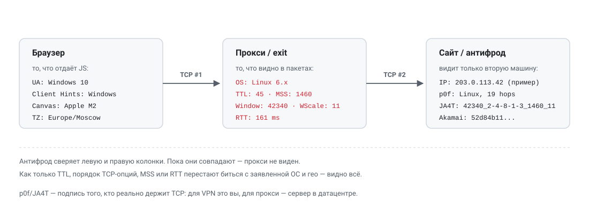

# §0. Две реальности, которые антифрод сравнивает

[Главная](../../README.md) · [Часть 2](README.md) · [§1. IP и ASN →](01-ip-asn.md)

Прокси — это не «транспорт». Это два независимых TCP-сегмента: **браузер → прокси** и **прокси → сайт**. Сайт видит только второй. Всё, что можно измерить на сетевом уровне — initial TTL, MSS, размер окна, порядок TCP-опций, IP ID, RTT, джиттер, скорость — это характеристики **exit-машины**, а не пользователя.

Всё, что приходит на уровне приложения — User-Agent, Client Hints, Canvas, WebGL, шрифты, WebRTC, DNS — принадлежит браузеру. Антифрод сверяет эти две картинки. Пока они сходятся — прокси невидим. Как только расходятся — видно всё.

Ключевая разница между типами прокси, которую часто путают:

| Схема | Кто держит TCP #2 | Чья p0f-подпись | Что выдаёт |
|---|---|---|---|
| HTTP/HTTPS-прокси, SOCKS5 | прокси-сервер | **сервера** (обычно Linux) | TTL/p0f не совпадает с UA |
| VPN / туннель (WireGuard, OpenVPN) | ваш роутер/ОС | **ваша** | TTL −1 к наблюдаемому, урезанный MSS, нестандартный MTU |
| MITM-прокси (Burp, mitmproxy, антивирус) | прокси-сервер | сервера | свой TLS-сертификат, JA3/JA4 не как у Chrome |
| «Резидентский» реверс-прокси | чужая машина | **чужой реальной ОС** | совпадает, пока машина жива и не ротировалась |

Отсюда первый вывод: **p0f-подпись — это подпись того, кто реально держит TCP.** Для VPN это вы, для прокси — сервер в датацентре, для «резидентского» пула — чужая Windows-машина, которую вы не контролируете.

И второй, менее очевидный: **подделка на сетевом уровне ограничена.** UA и Client Hints можно переписать в браузере; TTL можно переписать в iptables; а вот порядок TCP-опций, поведение timestamps и физику RTT — уже нет, не сломав соединение ([§2](02-ttl.md), [§3](03-p0f-ja4t.md), [§5](05-rtt.md), [§13](../4-checks/13-tuning.md)).

---

**Смотрите также:** [§14. IPv6 и dual-stack](../5-gaps/14-ipv6-dualstack.md) — вторая семья адресов добавляет вторую «реальность»; [§15. HTTP/3 и QUIC](../5-gaps/15-http3-quic.md) — второй транспорт, который может уйти мимо туннеля.

### Источники

- p0f — [описание пассивного фингерпринтинга и полей](https://github.com/p0f/p0f/blob/master/docs/README); JA4T — [FoxIO](https://github.com/FoxIO-LLC/ja4).
- ValdikSS, [Detecting VPN (and its configuration!) and proxy users on the server side](https://medium.com/@ValdikSS/detecting-vpn-and-its-configuration-and-proxy-users-on-the-server-side-1bcc59742413).
- BrowserLeaks: [/tcp](https://browserleaks.com/tcp), [/ip](https://browserleaks.com/ip).

---

[Оглавление](../README.md) · [§1. IP и ASN →](01-ip-asn.md)
