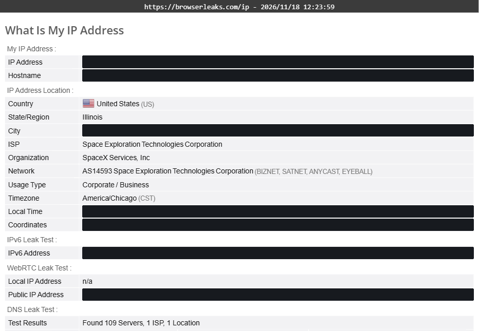

# §1. IP и ASN: уровень 0, дешёвый и шумный

[Главная](../../README.md) · [Часть 2](README.md) · [← §0](00-two-realities.md) · [§2. TTL →](02-ttl.md)

Самое первое, что смотрит любой риск-движок — не пакеты, а метаданные IP. Это дёшево, быстро и даёт априорную вероятность.

- **Тип ASN.** BrowserLeaks на `/ip` рисует теги сети: `VPN Host`, `CDN`, `Server Hosting (VPSH)`, `TOR`, `DDoS Mitigation`, `Anycast`, `Content`, `EYEBALL`, `SATELLITE`. Это ровно тот датасет, который в продакшене покупают у ipinfo, IPQualityScore, MaxMind (Anonymous IP) или Spur — публичные доки в [источниках](../references.md).
- **Usage Type.** `Corporate / Business`, `ISP / Residential`, `Cellular` — разница между «домашний абонент» и «серверная стойка».
- **PTR-запись.** `dsl-…`, `static.…pppoe…` — жилой провайдер; `hosted-by-…`, `vps-…` — хостинг. Обратный DNS врёт редко.
- **Списки.** Spamhaus PBL/XBL, Tor exit-листы, публичные списки открытых прокси, сканы IPv4 на порты 1080/3128/8080/8118, honeypot-сети вроде Spur, которые специально принимают прокси-трафик и помечают узлы.
- **Геолокация + время.** Город, часовой пояс, локальное время. Если IP «в Токио», а браузер живёт в `Europe/Moscow` — это несоответствие, которое стоит в одном ряду с прокси.
- **IPv6.** Отдельная строка и отдельная история: у адреса может быть другая гео/ASN-картина, а `/64` вообще кластеризуется как один абонент ([§14](../5-gaps/14-ipv6-dualstack.md)).

*Эталонный прогон: `AS14593 Space Exploration Technologies Corporation` с тегами `(BIZNET, SATNET, ANYCAST, EYEBALL)`, usage `Corporate / Business`, TZ `America/Chicago`. Обратите внимание: даже «чистый» жилой-ish Starlink несёт теги — `SATELLITE` и `Corporate/Business`. Это не приговор, а prior: теги описывают сеть, а не пользователя. Для контраста — [тот же экран на антипримере](../../screenshots/bad/ip.png): `AS199524 G-Core Labs (VPN, CDN, VPSH, TOR, DDOSM, ANYCAST, CONTENT)`.*

Важно: это **не доказательство**, а prior. Датацентр — подозрение по умолчанию. Residential — «пока чистый, но докажи». Поэтому дальше идут пакеты.

Ещё две вещи, которые видно уже здесь, без всяких фингерпринтов:

1. **Совпадение гео и часового пояса.** IP в Чикаго, TZ `America/Chicago`, локальное время сходится — норма. IP в Токио, TZ `Europe/Moscow` — расхождение. Но осторожно: TZ может быть выставлен вручную, а CGNAT и Anycast любят врать ([§9](../3-browser/09-false-positives.md)).
2. **IPv6-строка.** Если `/ip` показывает IPv6-адрес, а HTTP-запросы идут по IPv4 — это не «утечка» сама по себе, но повод проверить, какой семейство реально несёт туннель. Если IPv6-адрес не совпадает по ASN/гео с IPv4 — это уже сигнал ([§14](../5-gaps/14-ipv6-dualstack.md)).

---

### Источники

- Вендорские описания датасетов: [ipinfo Proxy & VPN Detection](https://ipinfo.io/data/proxy-vpn-detection) · [IPQualityScore Proxy Detection API](https://www.ipqualityscore.com/documentation/proxy-detection-api/overview) · [MaxMind Anonymous IP](https://www.maxmind.com/en/geoip-anonymous-ip-database) · [Spur Context API](https://docs.spur.us/) · [Cloudflare Bot Score](https://developers.cloudflare.com/bots/concepts/bot-score/).
- [Spamhaus PBL/XBL](https://www.spamhaus.org/) · [Tor exit list](https://check.torproject.org/torbulkexitlist) · [BrowserLeaks /ip](https://browserleaks.com/ip).

---

[← §0](00-two-realities.md) · [Оглавление](../README.md) · [§2. TTL →](02-ttl.md)
