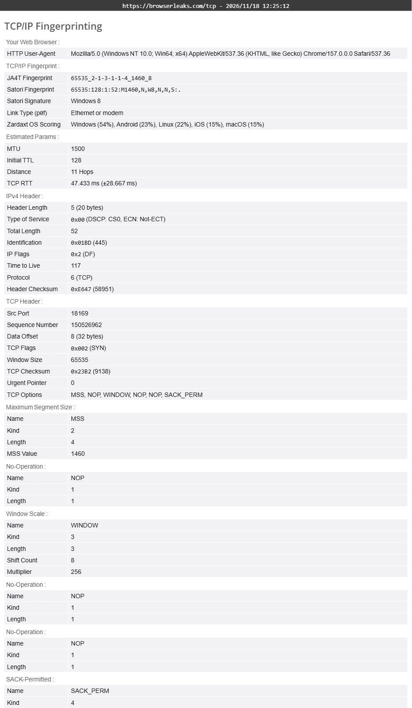
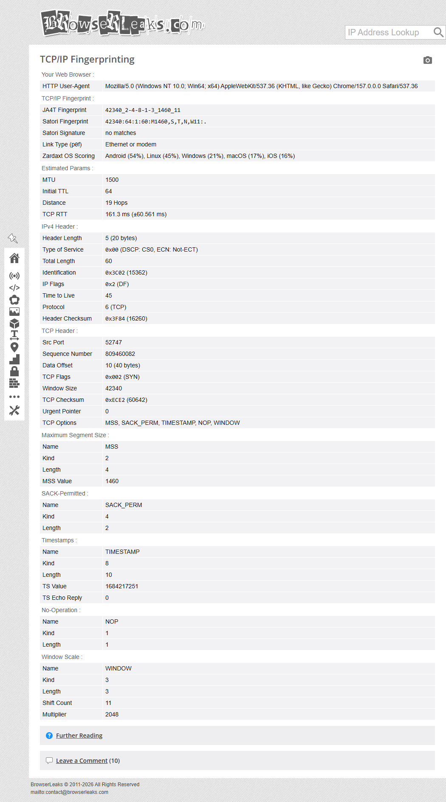

# §3. p0f и JA4T: подпись TCP-стека

[Главная](../../README.md) · [Часть 2](README.md) · [← §2](02-ttl.md) · [§4. MSS и MTU →](04-mss-mtu.md)

p0f (и его современные родственники — Satori, Zardaxt, JA4T) — это пассивный фингерпринт по первому пакету, SYN. Он не требует ни JS, ни активных проб: сервер просто читает то, что ему прислали.

| Параметр | Что говорит |
|---|---|
| Initial TTL | семейство ОС (64/128/255) — см. [§2](02-ttl.md) |
| Window size | версия ядра/стек |
| MSS | MTU пути, наличие туннеля ([§4](04-mss-mtu.md)) |
| Window scale | версия стека |
| **Набор и порядок TCP-опций** | самый дискриминирующий признак |
| DF-бит | поколение стека |
| IP ID | поведение ядра (0 / инкремент / рандом) |
| TCP timestamps | включены/выключены, а также skew часов |

Порядок опций — это отпечаток пальца, потому что каждая ОС собирает список опций в своём порядке. Значения зависят от версии ядра и `sysctl`/реестра — это **ориентир, а не константа**, поэтому p0f и Zardaxt выдают не «ответ», а вероятности.

| Стек | Initial TTL | Window | WScale | MSS | Порядок опций |
|---|---|---|---|---|---|
| Linux 3.11+ (стоковый) | 64 | `29200` (≈ 20 × MSS) | 7 | 1460 | `MSS, SACK, TS, NOP, WS` |
| Linux (тюнингованный, как в антипримере) | 64 | `42340` | 11 | 1460 | то же |
| Windows 10/11 (штатный autotuning) | 128 | `64240` | 8 | 1460 | `MSS, NOP, WS, NOP, NOP, SACK_PERM` |
| Windows (autotuning off / свой тюнинг) | 128 | `65535` или `65464` | 8 | 1460 | то же, без `TIMESTAMP` в SYN |
| macOS / iOS | 64 | `65535` | 6 | 1460 | `MSS, NOP, WS, NOP, NOP, TS, SACK_PERM` |

*Почему у Windows два окна: штатный `AutoTuningLevel` даёт масштаб 8 и окно `64240` (44 × 1460), а при выключенном autotuning или ручном тюнинге в SYN уезжает `65535`/`65464`. Именно поэтому таблица из первой версии статьи с «65464–65535» была неполной: современный дефолт — `64240`, а `65535` — это уже конкретная настройка, которую видно на железе.*

## Как читать JA4T и что видно на стендах

Формат JA4T: `<window>_<опции>_<MSS>_<wscale>`, где номера видов: 2 = MSS, 4 = SACK, 8 = TIMESTAMP, 1 = NOP, 3 = WINDOW. Например, `65535_2-1-3-1-1-4_1460_8` = `MSS, NOP, WS, NOP, NOP, SACK_PERM`, окно `65535`, `WS 8`.

<table>
<tr>
<td width="50%"></td>
<td width="50%"></td>
</tr>
<tr>
<td><b>Эталон.</b> <code>JA4T 65535_2-1-3-1-1-4_1460_8</code>, <code>Satori: Windows 8</code>, <code>Zardaxt: Windows 54%</code>, <code>Initial TTL 128</code>. Окно <code>65535</code> — не «книжный дефолт», а настройка этой машины; порядок опций и отсутствие <code>TIMESTAMP</code> в SYN совпадают с Windows.</td>
<td><b>Антипример.</b> <code>JA4T 42340_2-4-8-1-3_1460_11</code>, <code>Satori Signature: no matches</code>, <code>Zardaxt: Android 54% / Linux 45% / Windows 21%</code>, <code>Initial TTL 64</code>. При этом <code>User-Agent</code> вверху — Windows. Это и есть p0f-UA mismatch в чистом виде.</td>
</tr>
</table>

*Оба прогона — один и тот же Chrome 157. Разница только в том, кто держит TCP: реальная Windows 11 или Linux-прокси в датацентре. Все параметры — в [§11](../4-checks/11-stands.md).*

**Почему это ломает прокси.** HTTP-прокси и SOCKS5 терминируют TCP и открывают новое соединение от себя. Значит, сайт видит SYN от прокси-сервера — обычно Ubuntu/Debian в датацентре. Итог: `p0f: Linux`, `UA: Windows NT 10.0`. Классика, по которой ещё в 2015-м отлавливали прокси-юзеров; работает до сих пор — просто теперь к ней добавились JA4T и JA4.

## Что такое «схожесть» в p0f

Тут три разных проверки, и все три важны:

1. **Схожесть с заявленной ОС.** `p0f` ↔ `User-Agent` ↔ `Client Hints` ↔ `navigator.platform`. Windows-браузер не может приехать с Linux-стеком.
2. **Схожесть внутри сессии.** Подпись не должна меняться между запросами. Если в середине сессии TTL/опции/окно поменялись — сменился exit, а «пользователь» остался тем же.
3. **Схожесть между сессиями (кластеризация).** Десятки «разных» профилей с одинаковым JA4T + одинаковым TCP timestamp skew + одинаковым порядком опций = одна exit-машина. Так антифрод склеивает фермы мультиаккаунтов, даже если каждый профиль на своём «чистом» IP.

Третья проверка — самая недооценённая. IP можно менять хоть каждую минуту, а TCP-стек и часы машины остаются те же. Zardaxt, например, специально обучает классификатор отличать relay от не-relay по признакам стека: в его feature importance порядок TCP-опций весит больше всего, а TTL — меньше ([источники](#источники)). Это не «p0f сказал Linux», это «статистика говорит, что так выглядит прокси».

## Одна позиция по `no matches`

В первой версии статьи `no matches` назывался «сам по себе флаг» в §3 и «не аномалия» в §4/§11. Правильная позиция одна: **`no matches` — не флаг.** Это значит «подписи нет в базе», и причин три:

1. **База старая.** В `p0f.fp` вообще нет сигнатуры Windows 10/11: последняя Windows-подпись — Windows 7/8 с окном `8192`. Современная Windows честно даёт `no matches`, и это возраст базы, а не признак прокси.
2. **Стек нестандартный.** Тюнингованные окна, кастомный MSS (туннель), нестандартные опции — всё это «неизвестно» для базы, хотя это нормальная машина ([§4](04-mss-mtu.md)).
3. **Это действительно прокси** — но установить это можно только по совокупности с UA/Client Hints/поведением, а не по самому факту отсутствия подписи.

Поэтому в разборе `no matches` нигде не считается отдельным сигналом. Это слабый признак «нетипичный стек», который имеет смысл только в ансамбле — ровно как и `Zardaxt: Windows 21%` рядом с `Android 54%`.

## Ограничения p0f-подхода

- **IPv6.** p0f поддерживает IPv6, но длина extension-заголовков (`olen`) для IPv6 не считается из-за ограничений libpcap; Satori в открытом виде вообще разбирает только IPv4; JA4T документирован как TCP-SYN-фингерпринт без явной IPv6-специфики. Для dual-stack профилей это отдельная дыра ([§14](../5-gaps/14-ipv6-dualstack.md)).
- **TLS/HTTP-слой.** p0f ничего не знает про JA4 и Akamai — это отдельные слои ([§7](../3-browser/07-browser-layer.md)).
- **CDN.** Если сайт за Cloudflare/Akamai, подпись видит CDN, а не бэкенд ([§12](../4-checks/12-scope.md)).
- **Сам p0f честно предупреждает:** «treat the output from this tool as advisory; the fingerprinting can be gambled with some minor effort». Это не оракул.

---

### Источники

- p0f — [README и семантика `no match`](https://github.com/p0f/p0f/blob/master/docs/README), [p0f.fp](https://github.com/p0f/p0f/blob/master/p0f.fp); JA4T — [FoxIO JA4+](https://github.com/FoxIO-LLC/ja4), [разбор JA4T](https://foxio.io/blog/ja4t-tcp-fingerprinting).
- Satori — [github.com/xnih/satori](https://github.com/xnih/satori); Zardaxt — [github.com/NikolaiT/zardaxt](https://github.com/NikolaiT/zardaxt) (метрики relay-классификатора и важность признаков).
- BrowserLeaks [/tcp](https://browserleaks.com/tcp); RFC 7323 (window scale, timestamps); Microsoft — [TCP/IP performance tuning](https://learn.microsoft.com/en-us/azure/virtual-network/virtual-network-tcpip-performance-tuning).

---

[← §2](02-ttl.md) · [Оглавление](../README.md) · [§4. MSS и MTU →](04-mss-mtu.md)
