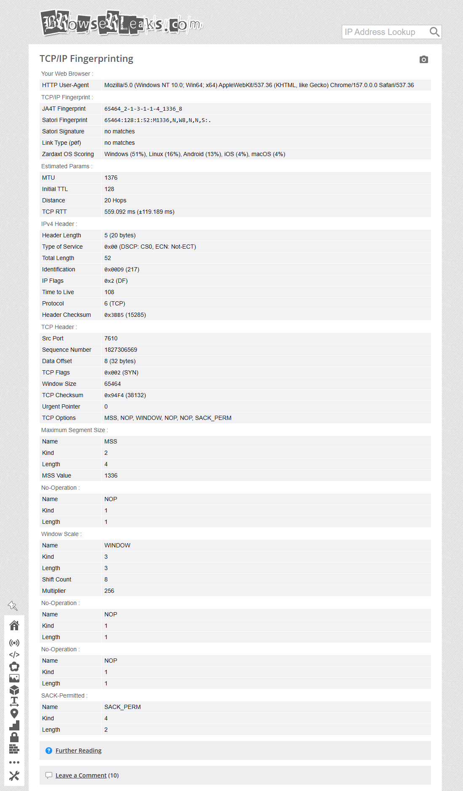

# §4. MSS и MTU: туннель видно по размеру сегмента

<sub>[Главная](../../README.md) · [Часть 2](README.md) · [← §3](03-p0f-ja4t.md) · [§5. RTT →](05-rtt.md)</sub>

MSS — это «сколько данных я готов принять в одном TCP-сегменте». Он напрямую выводится из MTU: `MSS = MTU − 40` (IPv4) или `− 60` (IPv6).

```
Чистый Ethernet:   MTU 1500 → MSS 1460
PPPoE (DSL):       MTU 1492 → MSS 1452
IPv6-путь:         MTU 1500 → MSS 1440
IPsec / GRE:       MTU 1400 → MSS 1360–1400
OpenVPN mssfix:    MSS зависит от шифра/MAC/сжатия, обычно 1300–1400
WireGuard:         MTU 1420 (типичный) → MSS 1380
AmneziaWG:         MTU 1376 в нашем прогоне → MSS 1336
```

*Значения — ориентир: `wg-quick` сам подбирает MTU под endpoint и маршрут, `mssfix` у OpenVPN настраивается, а IPsec/GRE бывают разной глубины. Проверять на конкретном туннеле, а не по таблице.*

Когда трафик едет в туннеле, ОС уменьшает MSS, чтобы пакеты не фрагментировались. И этот уменьшенный MSS приезжает на сервер как есть — даже если конфиг VPN «прозрачный».

Классика (ValdikSS, 2015): по MSS можно не только отличить OpenVPN, но и угадать его конфиг. `1369` — UDP, block 64, SHA1, без сжатия; `1367` — то же, но TCP; `1341` — уже SHA256. Достаточно одной цифры в SYN.

## Пример: WireGuard / AmneziaWG



*Тот же тест, но браузер выходит через WireGuard (форк AmneziaWG): TCP держит сама Windows. `Initial TTL 128`, окно `65464`, `WScale 8`, порядок опций `MSS, NOP, WINDOW, NOP, NOP, SACK_PERM` — и Zardaxt уверенно ставит Windows (51%). Туннель выдаёт себя одной цифрой: `MSS 1336` вместо 1460. Это MTU 1376 — обфускация AmneziaWG режет MTU сильнее стокового WireGuard (1420 → MSS 1380). Значения MTU зависят от конфигурации, это не «дефолт AmneziaWG» вообще.*

*`Satori Signature: no matches` и `Link Type (p0f): no matches` здесь **не аномалия**: нестандартный MSS просто не попал в базу подписей. Ровно та же история, что с современной Windows в [§3](03-p0f-ja4t.md).*

Что это значит на практике:

- `MSS 1460` при заявленном «мобильном» UA — подозрительно: у сотовых операторов MTU почти всегда меньше, а часть операторов вообще проксирует трафик.
- `MSS < 1460` при «домашнем» проводном подключении — почти наверняка туннель.
- `MTU 1500` + `MSS 1460` — норма для FTTH/кабеля, но аномалия для «мобильного» профиля (там обычно 1400–1420) и для дешёвых прокси, которые гоняют трафик через туннель.
- `MSS 1460` при exit, который сам сидит за туннелем, — тоже сигнал: прокси-ферма может показывать «чистый Ethernet», хотя трафик пришёл по WG.

Сюда же: DF-бит и поведение при PMTU. Туннели с включённым DF и заблокированным ICMP дают характерные «залипания» на больших пакетах: страница долго не грузит крупный ресурс, а мелкие идут. Это поведенческий сигнал, который виден и без пакетов ([§6](06-throughput.md)).

## Как MSS связан с IPv6

Для IPv6 заголовок на 20 байт больше, поэтому `MSS = MTU − 60`: при MTU 1500 это 1440, а не 1460. Если в `/tcp` видно `MSS 1440`, это не обязательно «IPv6-туннель» — это может быть IPv4-путь с MTU 1500 и... нет, для IPv4 это будет 1460; 1440 — признак того, что соединение шло по IPv6 либо MSS был искусственно занижен. Подробнее — [§14](../5-gaps/14-ipv6-dualstack.md).

---

### Источники

- RFC 879 (MSS option), RFC 8200 §8.3 (MSS для IPv6), RFC 1191 (PMTU), RFC 2516 (PPPoE, MTU 1492).
- Microsoft — [MSS и MTU: `MSS = MTU − (IP + TCP headers)`, побеждает меньшее значение](https://learn.microsoft.com/en-us/azure/virtual-network/virtual-network-tcpip-performance-tuning).
- `iptables` TCPMSS — [iptables-extensions(8)](https://man7.org/linux/man-pages/man8/iptables-extensions.8.html); WireGuard — [wg-quick(8), автоподбор MTU](https://git.zx2c4.com/wireguard-tools/plain/src/man/wg-quick.8); OpenVPN — [mssfix](https://openvpn.net/community-resources/reference-manual-for-openvpn-2-6/).
- ValdikSS — [Detecting VPN and its configuration on the server side](https://medium.com/@ValdikSS/detecting-vpn-and-its-configuration-and-proxy-users-on-the-server-side-1bcc59742413).
- BrowserLeaks [/tcp](https://browserleaks.com/tcp).

---

<sub>[← §3](03-p0f-ja4t.md) · [Оглавление](../README.md) · [§5. RTT →](05-rtt.md)</sub>
