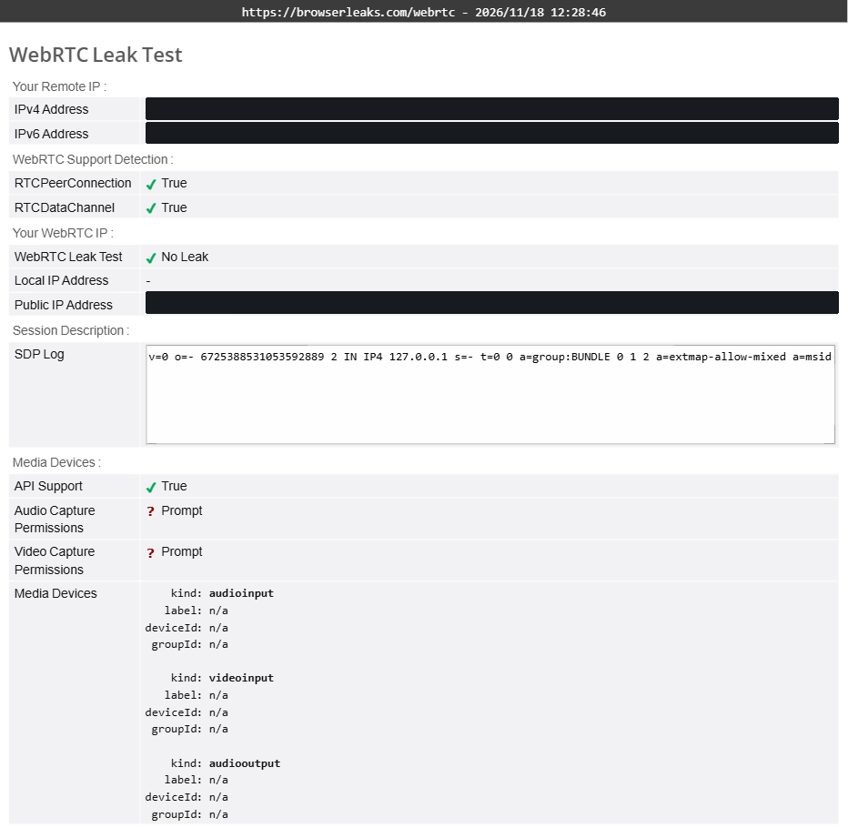
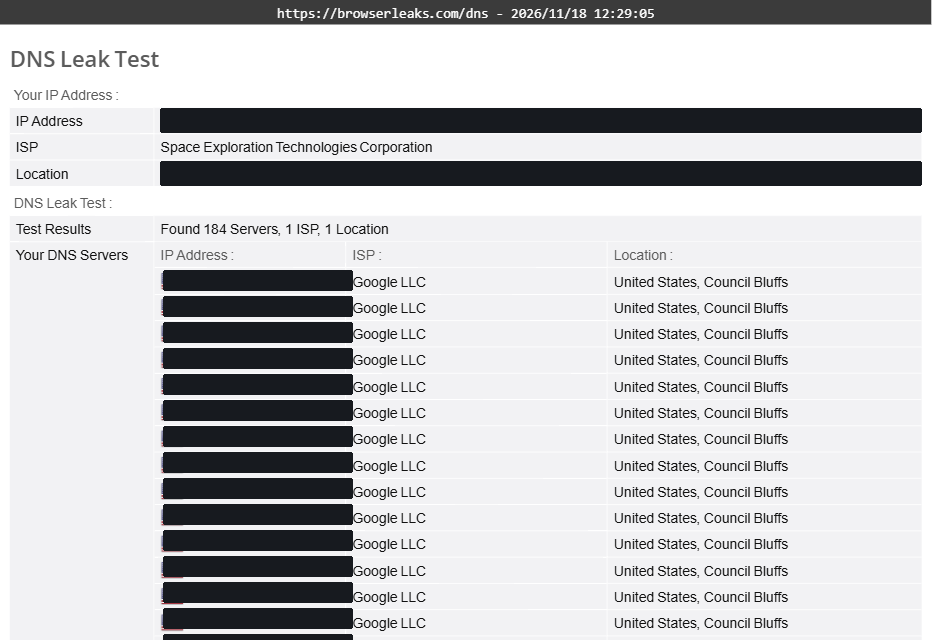
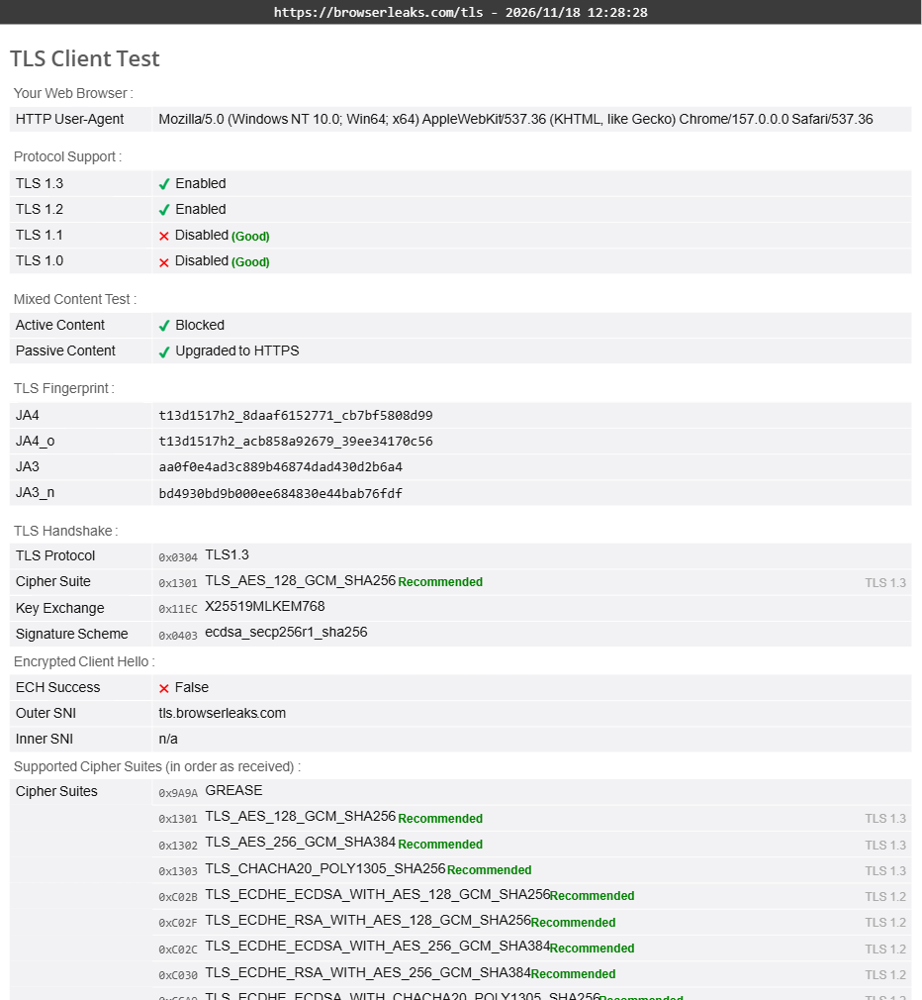
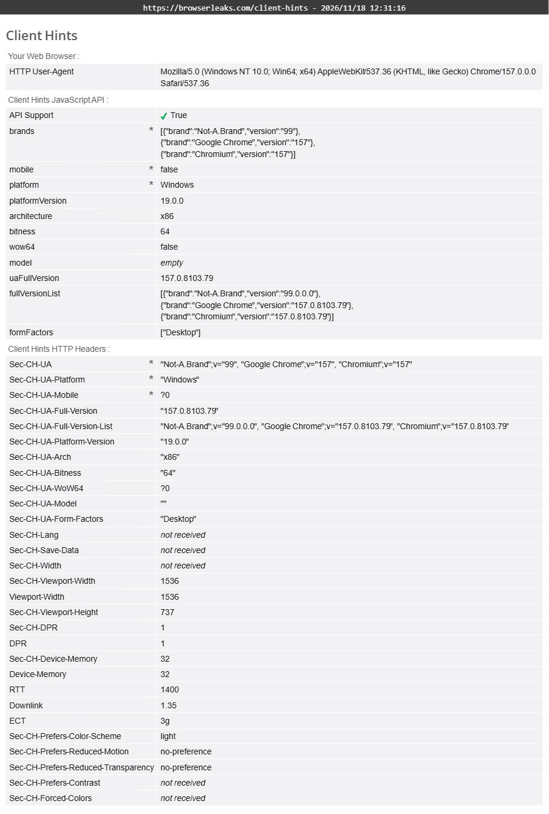

# §7. Браузерный слой: BrowserLeaks как рентген

[Главная](../../README.md) · [Часть 3](README.md) · [← §6](../2-network/06-throughput.md) · [§8. Скоринг →](08-scoring.md)

Сетевой слой — половина дела. Вторая половина — то, что отдаёт сам браузер. Ниже — карта страниц BrowserLeaks, которые стоит открывать из тестируемого профиля, и что именно на них искать.

| Страница | Что показывает | Что искать |
|---|---|---|
| `/ip` | IP, ASN-теги, гео, TZ, локальное время, PTR, заголовки, Tor, IPv6-утечка | `VPN Host`/`VPSH`, TZ IP ≠ TZ браузера, `Via`/`X-Forwarded-For`, IPv6 ≠ IPv4 |
| `/tcp` | JA4T, Satori, Zardaxt, MTU, initial TTL, distance, TCP RTT | OS ≠ UA, MSS < 1460, RTT не бьётся с гео |
| `/webrtc` | Local IP, Public IP через STUN, SDP, устройства | public IP ≠ HTTP IP, реальный local IP вместо mDNS |
| `/dns` | Резолверы | утечка резолвера мимо туннеля (домашний ISP при зарубежном exit) — жёсткий сигнал; «не в городе» — мягкий |
| `/tls` | JA3/JA4, шифры, ECH | JA4 не как у заявленного Chrome |
| `/http2` | Akamai-фингерпринт (SETTINGS, WINDOW_UPDATE, порядок pseudo-header'ов) | отпечаток библиотеки (requests/curl), а не браузера |
| `/quic` | HTTP/3-фингерпринт, JA4 для QUIC, transport parameters | QUIC есть, а UDP через прокси не ходит ([§15](../5-gaps/15-http3-quic.md)) |
| `/client-hints` | UA-CH: brands, platform, platformVersion, high-entropy hints | CH ≠ UA, «Linux» при UA Windows, пустые high-entropy поля |
| `/proxy` | HTTP Proxy-заголовки, Tor, letterboxing, content filters | `Via`, `Proxy-Connection`, детект Tor Browser |
| `/fonts`, `/canvas`, `/webgl` | Платформенные отпечатки | macOS-шрифты при Windows-UA, софтверный WebGL |

## WebRTC

`RTCPeerConnection` + STUN — отдельный UDP-путь. Он не всегда идёт «мимо прокси»: куда именно он пойдёт, зависит от типа прокси.

| Режим | STUN/ICE | Что видит сайт |
|---|---|---|
| HTTP/HTTPS-прокси (CONNECT) | мимо прокси, с машины | реальный public IP → утечка |
| SOCKS5 без UDP ASSOCIATE | мимо прокси, UDP не проксируется | та же утечка |
| SOCKS5 с UDP / TUN-VPN (WireGuard, AmneziaWG) | внутри туннеля, через exit | public IP = IP exit'а |

Поэтому формулировка «WebRTC всегда напрямую» неверна: для HTTP-прокси это так, для TUN-VPN — нет ([§11](../4-checks/11-stands.md)). Современный Chrome маскирует локальные адреса mDNS-именами (`.local`), но публичный IP через STUN остаётся.

На эталонном скриншоте утечки нет (`No Leak`), public IP совпадает с HTTP-IP, local — `n/a`/mDNS. **Важно:** «No Leak» сам по себе ничего не доказывает — в антипримере он тоже `No Leak`, хотя это headless Linux через датацентр: STUN-ответ мог просто не прийти, а не «прокси всё закрыл». Утечка появляется, когда браузер пускает STUN в обход прокси; её отсутствие — необходимое, но не достаточное условие ([§9](09-false-positives.md)).

Отдельно про IPv6: в dual-stack профиле WebRTC может отдавать **IPv6-кандидата**, даже если HTTP идёт по IPv4-прокси. Это вторая утечка, о которой забывают ([§14](../5-gaps/14-ipv6-dualstack.md)).

## DNS

Резолвер, который видит сайт, должен быть «рядом» с exit. В эталоне exit — Starlink (США, Чикаго), и все резолверы — `Google LLC`, `United States, Council Bluffs` (anycast-точка Google): страна совпадает, город — нет, и это нормально для публичного anycast-резолвера.

В антипримере exit — Токио, а резолверы — `Cloudflare`/`WoodyNet` с anycast-PoP в Сингапуре. Это **не утечка**: публичные anycast-резолверы показывают точку присутствия, а не адрес пользователя. Настоящая утечка выглядела бы иначе: домашний ISP-резолвер, который резолвит ваш трафик в обход туннеля.

Одна шкала, как в [§8](08-scoring.md), без «+25»:

- **Мягкий сигнал:** резолвер не в городе exit. Anycast и публичный DoH дают именно это; сам по себе сигнал ничего не значит.
- **Сильный мягкий:** резолвер в другой стране/ASN, чем заявленная геолокация профиля. В ансамбле с остальным — картина, по одному — ещё нет.
- **Жёсткий блокер:** только прямая несовместимость — резолвер домашнего ISP пользователя при заявленном зарубежном exit, то есть DNS утекает мимо туннеля. Это не «anycast не в том городе», а два разных пути для HTTP и DNS.

## TLS и HTTP/2

`JA4 = t13d1517h2_8daaf6152771_cb7bf5808d99` — это Chrome 157. Обратите внимание на две вещи:

- **JA3 «плывёт» между соединениями.** В `/ip` хеш `87ee…`, в `/tls` — `aa0f…`: Chrome рандомизирует порядок TLS-расширений, поэтому MD5-хеш JA3 меняется от коннекта к коннекту. JA4 это лечит: расширения и шифры сортируются, хеш стабилен. Если антифрод использует JA3 как «отпечаток браузера», он ловит шум; JA4 — нет.
- **ECH выключен** (`ECH Success: False`), но это не «неправильно»: ECH — опция, и её отсутствие не отличает Chrome от Chrome. ECH описан в RFC 9849 (март 2026), конфиг раздаётся через SVCB/HTTPS-записи (RFC 9848); даже при включённом ECH наружу уходит `ClientHelloOuter`, и JA3/JA4 по нему остаются возможны.

Для CONNECT-туннеля (SOCKS5, HTTPS-прокси) TLS-фингерпринт остаётся клиентским — прокси видит только шифрованный поток. А вот MITM-прокси (Burp, mitmproxy, корпоративный антивирус) терминирует TLS и подставляет свой — и тогда JA4 соответствует не Chrome, а Go/Python/OpenSSL. Дополнительный маркер — цепочка сертификатов с локальным CA.

HTTP/2-фингерпринт (Akamai Hash `52d84b11737d980aef856699f885ca86`) в обоих стендах одинаков — потому что браузер один и тот же, Chrome 157. Он ловит не «прокси», а подмену клиента: `requests`, `curl`, headless-библиотека дадут другой набор SETTINGS/приоритетов. Если у вас «Chrome UA», а Akamai-хеш от библиотеки — это жёстче, чем любой TTL.

## Client Hints

Здесь важно не «Windows» в `Sec-CH-UA-Platform`, а согласованность:

- `UA` говорит `Windows NT 10.0`, `Sec-CH-UA-Platform` — `"Windows"`, `platformVersion` — `19.0.0`. `platformVersion` в Chrome выводится из `UniversalApiContract` (константа 19 в Chromium) — то есть это не «версия Windows» в привычном смысле, а внутренний контракт; подделать его вручную можно, но легко промахнуться.
- brands, `fullVersionList` и `uaFullVersion` (157.0.8103.79) должны указывать на один и тот же Chrome.
- high-entropy поля (`architecture x86`, `bitness 64`, `wow64 false`, `model ""`, `formFactors Desktop`) должны сходиться с UA и `navigator.platform`.
- **RTT `1400`, `downlink 1.35`, `ECT 3g`** — это NQE-оценка сети самим Chrome. На «идеальном» эталоне она плохая: прокси добавляет задержку. Это не сетевой фингерпринт, но объясняет, почему у профиля могут «плыть» тайминги ([§6](../2-network/06-throughput.md)).

Типичные ошибки подмены: UA от Chrome 157, а `Sec-CH-UA-Full-Version` от 149; `platformVersion 10.0.0` при Windows 11; пустые `Sec-CH-UA-Arch`/`Bitness` при заявленном Win64; `model` непустой у десктопа. Каждая — маленькое расхождение, но вместе они складываются в «франкенштейн» ([§8](08-scoring.md)).

## Заголовки и локальные прокси

Прозрачный прокси палится ещё до JS: `Via: 1.1 squid`, `X-Forwarded-For`, `Forwarded`, `X-Real-IP`, `Proxy-Connection: keep-alive`. Страница `/ip` показывает сырые заголовки — это первое, что стоит смотреть.

Отдельный трюк — тайминговый скан `127.0.0.1:8080/3128/8888/9090/1080` из JS: закрытый порт отказывает мгновенно, открытый — иначе. Так ловят Burp/mitmproxy/Charles, которые стоят на машине и не видны снаружи. Это уже поведенческий слой, а не сетевой, и он не чинится заменой exit ([§16](../5-gaps/16-headless.md)).

---

### Источники

- BrowserLeaks: [/ip](https://browserleaks.com/ip) · [/tcp](https://browserleaks.com/tcp) · [/webrtc](https://browserleaks.com/webrtc) · [/dns](https://browserleaks.com/dns) · [/tls](https://browserleaks.com/tls) · [/http2](https://browserleaks.com/http2) · [/quic](https://browserleaks.com/quic) · [/client-hints](https://browserleaks.com/client-hints) · [/proxy](https://browserleaks.com/proxy).
- WebRTC — [MDN: connectivity и ICE-кандидаты](https://developer.mozilla.org/en-US/docs/Web/API/WebRTC_API/Connectivity), [mDNS ICE candidates (IETF draft)](https://datatracker.ietf.org/doc/draft-ietf-mmusic-mdns-ice-candidates/).
- DNS — RFC 8484 (DoH), RFC 7858 (DoT).
- TLS/ECH — [RFC 9849 (ECH)](https://www.rfc-editor.org/rfc/rfc9849.html), [RFC 9848 (SVCB)](https://www.rfc-editor.org/rfc/rfc9848.html); [JA3 (Salesforce)](https://github.com/salesforce/ja3), [JA4 (FoxIO)](https://github.com/FoxIO-LLC/ja4); Akamai — [Passive fingerprinting of HTTP/2 clients](https://www.akamai.com/blog/security/passive-fingerprinting-of-http-2-clients).
- Client Hints — [Chrome for Developers: UA-CH](https://developer.chrome.com/docs/privacy-security/user-agent-client-hints/), [MDN `userAgentData`](https://developer.mozilla.org/en-US/docs/Web/API/Navigator/userAgentData), [Chromium `user_agent_utils.cc`](https://source.chromium.org/chromium/chromium/src/+/main:components/embedder_support/user_agent_utils.cc).

---

[← §6](../2-network/06-throughput.md) · [Оглавление](../README.md) · [§8. Скоринг →](08-scoring.md)
