# §11. Стенд: эталон и антипример

<sub>[Главная](../../README.md) · [Часть 4](README.md) · [← §10](10-checklist.md) · [§12. Границы →](12-scope.md)</sub>

Все скриншоты в разборе — из двух прогонов, и это важнее, чем кажется. Первая версия статьи показывала только один стенд — худший случай: headless-браузер на Linux, UA подменён на Windows, exit в датацентре с тегами TOR/VPN. По таким скриншотам невозможно понять, как выглядит **нормальная** конфигурация: видно только, как всё ломается.

Теперь стендов два:

- **Эталон** — реальная Windows 11, Chrome 157, живое подключение Starlink (AS14593, США). Слои сходятся: сеть, браузер, гео и Client Hints говорят одно и то же.
- **Антипример** — Chromium 157 headless на Linux, UA/Client Hints подменены на Windows, exit — G-Core Labs в Токио (AS199524). Слои расходятся: браузер врёт, TCP-стек говорит правду.

Оба прогона — один и тот же Chrome 157 (157.0.0.0 в UA, 157.0.8103.79 в Client Hints), поэтому различия в TLS/HTTP2-фингерпринтах минимальны, а различия в TCP/IP — принципиальны.

## Все параметры в одной таблице

| Параметр | Эталон (Windows 11 + Starlink) | Антипример (headless Linux + G-Core) |
|---|---|---|
| Клиент | Windows 11, Chrome 157, обычный браузер | Linux, Chromium 157 headless, UA override на Windows |
| Exit | SpaceX/Starlink, AS14593, США, Иллинойс (Чикаго) | G-Core Labs, AS199524, Япония, Токио |
| ASN-теги | `BIZNET, SATNET, ANYCAST, EYEBALL` | `VPN, CDN, VPSH, TOR, DDOSM, ANYCAST, CONTENT` |
| Usage Type | `Corporate / Business` | `Corporate / Business` |
| Initial TTL | 128 | 64 |
| Observed TTL / Distance | 117 / 11 хопов | 45 / 19 хопов |
| Window / WScale | 65535 / 8 | 42340 / 11 |
| Порядок опций | `MSS, NOP, WS, NOP, NOP, SACK_PERM` (без TS) | `MSS, SACK, TS, NOP, WS` |
| JA4T | `65535_2-1-3-1-1-4_1460_8` | `42340_2-4-8-1-3_1460_11` |
| MSS / MTU | 1460 / 1500 | 1460 / 1500 |
| TCP RTT | 47.433 мс (±28.667) | 161.3 мс (±60.561) |
| Satori | `Windows 8` | `no matches` |
| Zardaxt | Windows 54%, Android 23%, Linux 22%, iOS 15%, macOS 15% | Android 54%, Linux 45%, Windows 21%, macOS 17%, iOS 16% |
| WebRTC | `No Leak`, public IP = HTTP IP, IPv4 + IPv6 | `No Leak`, public IP = HTTP IP, IPv6 `n/a` |
| IPv6 | есть (HTTP и DNS по IPv6) | нет (`n/a`) |
| DNS | `Google LLC`, США, Council Bluffs (anycast), 184 сервера / 1 ISP | `Cloudflare` + `WoodyNet`, Сингапур (anycast), 14 серверов |
| TLS JA4 | `t13d1517h2_8daaf6152771_cb7bf5808d99` | `t13d1517h2_8daaf6152771_cb7bf5808d99` |
| ECH | `False` | `False` |
| JA3 | `87ee…` в `/ip`, `aa0f…` в `/tls` — «плывёт» | `9355…` в `/ip` — тоже «плывёт» |
| Akamai HTTP/2 | `52d84b11737d980aef856699f885ca86` | `52d84b11737d980aef856699f885ca86` |
| Client Hints | Windows, `platformVersion 19.0.0`, x86, 64, 32 ГБ, DPR 1, `ECT 3g` | UA-CH подменены на Windows; согласованность не гарантирована |
| QUIC | соединение есть, `JA4 q13d0312h3_55b375c5d22e_178839b6cec1`, RTT 1315 мс | в этом прогоне не снимался |
| Headless-артефакты | нет (обычный браузер) | есть (headless + автоматизация), см. [§16](../5-gaps/16-headless.md) |

## Что читается из эталона

- **Стек совпадает с UA.** `Initial TTL 128`, окно `65535`, `WS 8`, порядок `MSS, NOP, WS, NOP, NOP, SACK_PERM`, Satori — `Windows 8`, Zardaxt — Windows 54%. Это не «идеальная подпись», а живая Windows, у которой окно `65535` — не табличный `64240`, а значение этой конфигурации (autotuning/буферы/настройка — точную причину по одному SYN не установить). И `65464` — не «второй дефолт Windows»: это `49 × 1336`, окно туннеля с MSS 1336 (см. [§4](../2-network/04-mss-mtu.md)); при MSS 1460 такого окна не бывает. А `65535` при MSS 1460 не кратно MSS — то есть «Windows всегда округляет окно вниз до MSS» неверно как общее правило ([§3](../2-network/03-p0f-ja4t.md)).
- **Слои сходятся.** Client Hints — Windows, `platformVersion 19.0.0`, `x86/64`, 32 ГБ RAM; TLS — Chrome 157; IPv6 работает и в HTTP, и в WebRTC; WebRTC public IP = HTTP IP; DNS — США.
- **Но и у эталона есть хвосты.** Usage `Corporate / Business`, теги `SATNET/BIZNET`, QUIC-RTT `1315 мс` при TCP-RTT `47 мс`, `ECT 3g` в Client Hints, ECH выключен, JA3 «плывёт». Это и есть честный ответ на вопрос «а идеальный профиль существует?» — идеального нет, есть согласованный.

## Что читается из антипримера

- **Расхождение в чистом виде.** UA — Windows, а `Initial TTL 64`, окно `42340`, `WS 11`, опции с `TIMESTAMP`, Satori — `no matches`, Zardaxt — Android 54% / Linux 45%. Это не «прокси детектится по TTL»: это два слоя, которые говорят разное.
- **`no matches` — не флаг.** Здесь он означает не «прокси», а «нестандартный Linux-стек + возраст базы» ([§3](../2-network/03-p0f-ja4t.md)). Ровно тот же `no matches` даёт нормальная Windows 11 в [§4](../2-network/04-mss-mtu.md) через туннель.
- **Инфраструктура видна.** Теги `VPN/CDN/VPSH/TOR`, датацентр в Токио, DNS-резолверы в Сингапуре, `IPv6 n/a` — картина «сервер, который притворяется пользователем».
- **Сеть тоже не идеальна.** `RTT 161 мс ±60.6` — это не домашний канал, а цепочка/датацентр.
- **WebRTC здесь не показатель.** `No Leak` в антипримере не доказывает, что UDP шёл через тот же exit: в headless STUN мог не ответить, а тип прокси в этом прогоне отдельно не фиксировался. Именно поэтому «No Leak» — необходимое, но не достаточное условие ([§7](../3-browser/07-browser-layer.md)).

## Третий прогон: что видит сервер, если на клиенте TUN-прокси

Это не стенд со скриншотами, а пакетный захват — он отвечает на вопрос «кто на самом деле держит TCP», который не виден на BrowserLeaks. Клиент — живая **Windows 10 Pro 19045**, поверх ОС запущен **tun2socks (AmneziaVPN)**, трафик выходит через G-Core Labs (AS199524, Токио). С клиента — обычный `curl` на тестовый Linux-сервер; на сервере — `tcpdump` по SYN.

Сервер увидел (IP заменены на документационные):

```
203.0.113.10.4783 > 198.51.100.20.9443: Flags [S], ttl 44,
    win 42340, options [mss 1460,sackOK,TS val ...,nop,wscale 11], length 0
```

Разбор: `Initial TTL 64` (64 − 20 хопов = 44), окно `42340` = 29 × 1460, `WS 11`, `MSS 1460`, порядок `MSS, SACK, TS, NOP, WS` — то есть JA4T `42340_2-4-8-1-3_1460_11`. Это **ровно** TCP-подпись антипримера из этой главы, хотя клиент — Windows, а не Linux: сервер видит стек выхода туннеля, а не стек клиентской ОС. «Прямое» соединение с локальным TUN-прокси не является прямым на уровне TCP.

Заодно это показывает, что `Distance` — длина пути, а не свойство машины: в антипримере TTL 45 / 19 хопов, в этом захвате TTL 44 / 20 хопов. Маршрут до другого сервера (и в другое время) отличается на хоп — TTL-«подпись» поехала, стек — нет.

Ограничение: снять SYN именно Windows-ядра на этой машине нельзя — TCP терминирует tun2socks. Для этого нужен хост без локального TUN (эталон со Starlink) или отключённый на время прогона TUN; это следующий шаг, а не результат этого прогона. Сырой вывод и скрипты — в [эксперименте](../../experiments/syn-and-rtt-gap/README.md).

## Чего стенд **не** доказывает

- **Что сайт ловит прокси по p0f.** Он доказывает другое: JS-слой и сетевой слой разошлись. Ровно такую же картинку даст UA-подмена на обычном Linux без всякого прокси — это аргумент против конкретной сборки, а не против прокси как такового.
- **Что так выглядит любой прокси.** Антипример — худший случай; эталонный прогон показывает, что бывает и согласованно.
- **Что видит CDN.** Оба прогона шли в BrowserLeaks, а не на сайт за Cloudflare/Akamai; за CDN подпись видит edge, а не бэкенд ([§12](12-scope.md)).
- **Поведение.** Скриншоты не показывают мышь, ввод, глубину сессии и историю аккаунта — а это часто решает больше, чем сеть.

## Скриншоты эталона

<details>
<summary><b>Развернуть все 9 скриншотов эталонного прогона</b></summary>

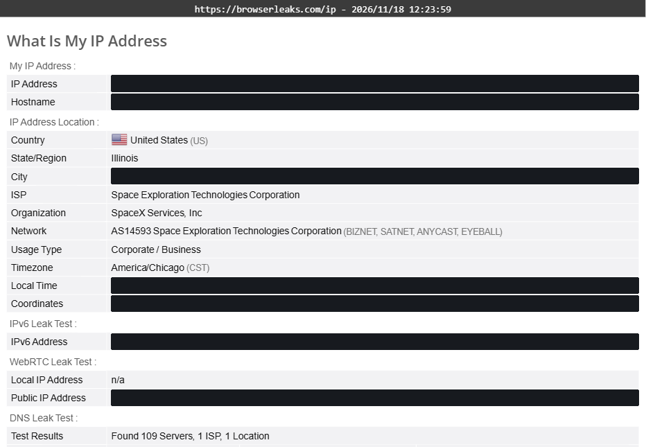

*`/ip`: AS14593 SpaceX, `BIZNET, SATNET, ANYCAST, EYEBALL`, usage `Corporate / Business`, TZ `America/Chicago`. IP, hostname, город, время и координаты замазаны.*

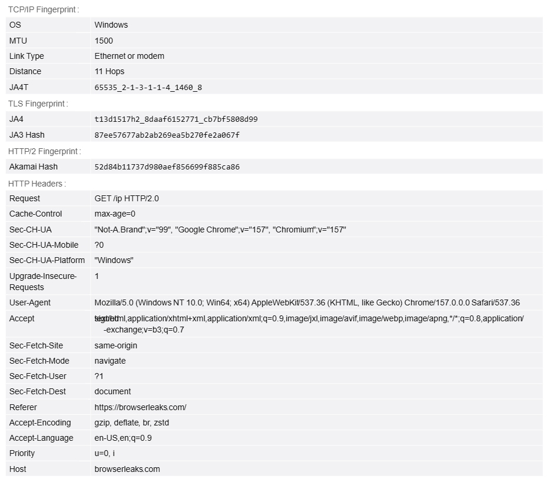

*`/ip` (продолжение): `OS Windows`, `MTU 1500`, `Distance 11 hops`, JA4T `65535_2-1-3-1-1-4_1460_8`, JA4 `t13d1517h2_…`, Akamai `52d84b…`, UA/CH — Windows/Chrome 157.*

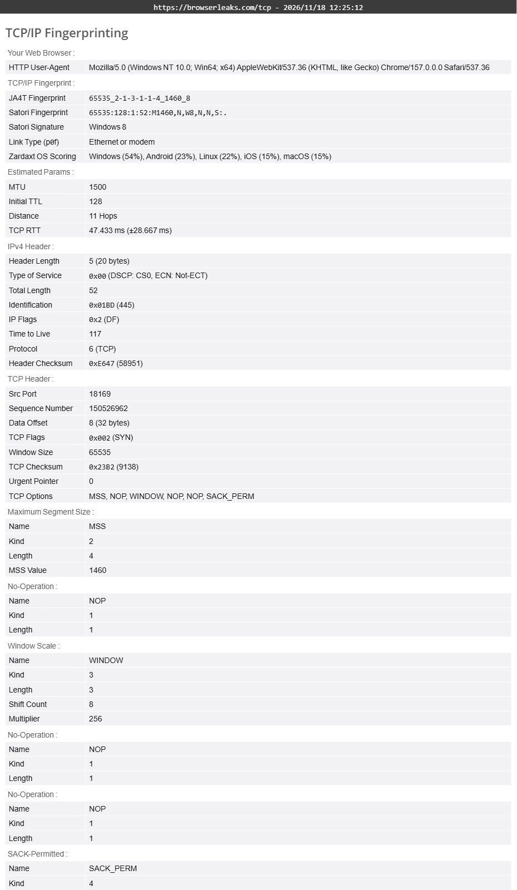

*`/tcp`: `JA4T 65535_2-1-3-1-1-4_1460_8`, `Satori Windows 8`, `Zardaxt Windows 54%`, `Initial TTL 128`, `Distance 11`, `TCP RTT 47.4 мс`.*

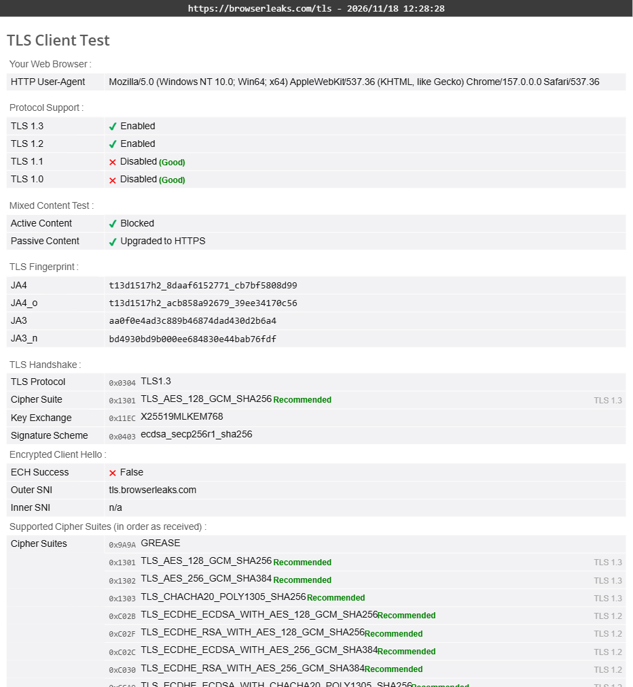

*`/tls`: `JA4 t13d1517h2_8daaf6152771_cb7bf5808d99`, JA3 `aa0f…`, TLS 1.3, X25519MLKEM768, ECH `False`.*

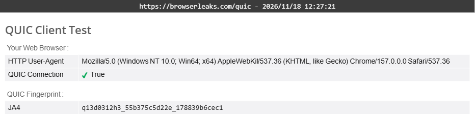

*`/quic`: `QUIC Connection: True`, `JA4 q13d0312h3_55b375c5d22e_178839b6cec1`, HTTP3-фингерпринт и хеш.*

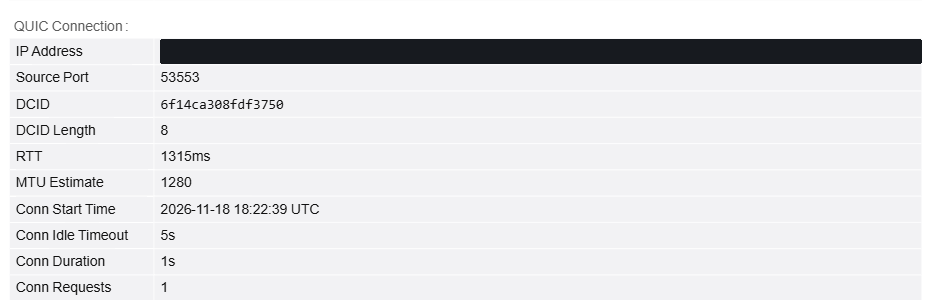

*`/quic` (продолжение): DCID, RTT `1315 мс`, MTU Estimate `1280`. UDP-путь заметно медленнее TCP — само по себе интересно.*

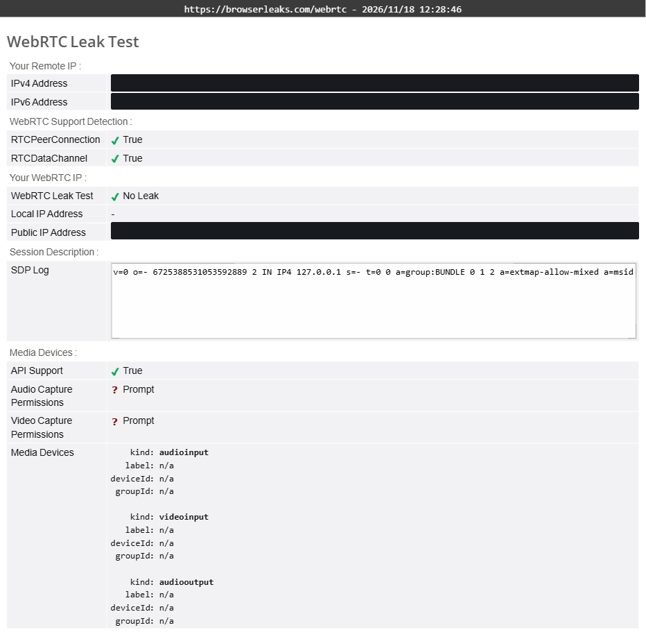

*`/webrtc`: `No Leak`, public IP совпадает с HTTP IP; local — `n/a`/mDNS. IPv6-адрес тоже замазан.*

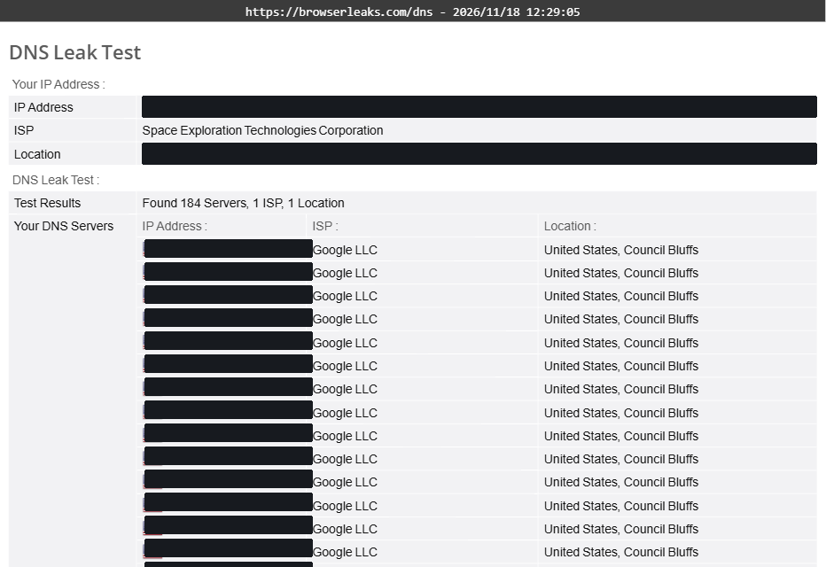

*`/dns`: 184 сервера, 1 ISP, `Google LLC`, `United States, Council Bluffs` (anycast). Не «утечка», а публичный резолвер.*

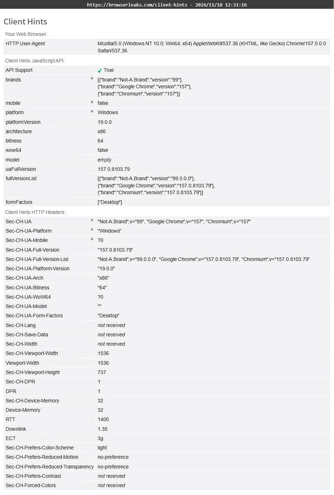

*`/client-hints`: Windows, `19.0.0`, x86/64, 32 ГБ, DPR 1, RTT `1400`, `ECT 3g`. Согласовано с UA; сеть при этом оценена как плохая.*

</details>

## Скриншоты антипримера

<details>
<summary><b>Развернуть 6 скриншотов провального прогона</b></summary>

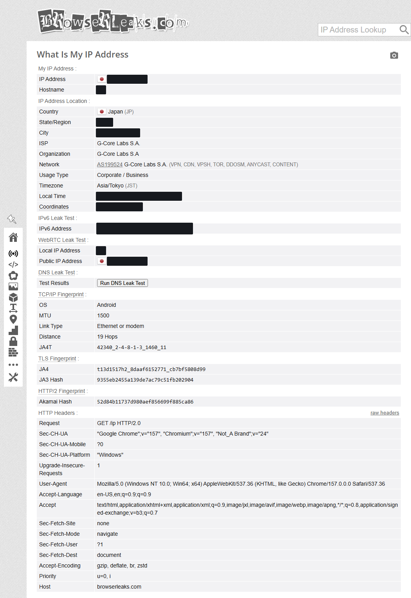

*`/ip`: `AS199524 G-Core Labs (VPN, CDN, VPSH, TOR, DDOSM, ANYCAST, CONTENT)`, Япония, Токио, `Asia/Tokyo`; при этом ниже — `OS: Android` и UA Windows.*

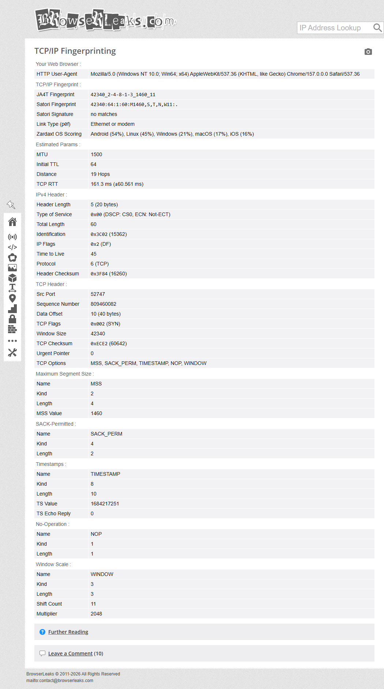

*`/tcp`: `JA4T 42340_2-4-8-1-3_1460_11`, `Satori no matches`, `Zardaxt Android 54% / Linux 45%`, `Initial TTL 64`, `Distance 19`, `TCP RTT 161 мс`.*

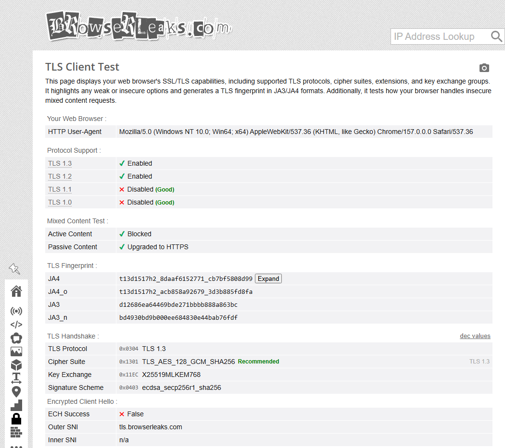

*`/tls`: JA4 тот же, что у эталона — потому что браузер тот же. Сетевой слой тут не при чём.*

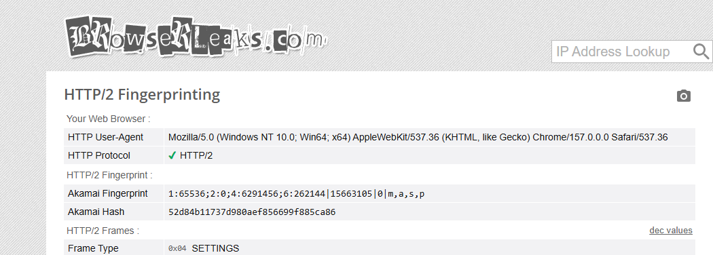

*`/http2`: Akamai-хеш `52d84b…` — снова совпадает с эталоном. Подмена UA не меняет HTTP/2-отпечаток.*

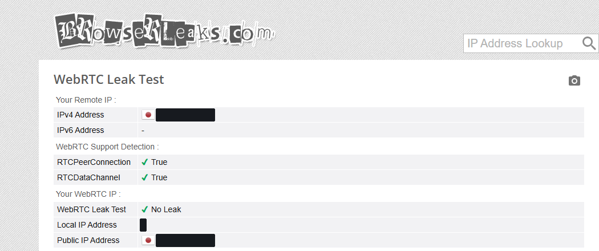

*`/webrtc`: `No Leak` и здесь. Отсутствие утечки не доказывает, что exit совпадает с профилем.*

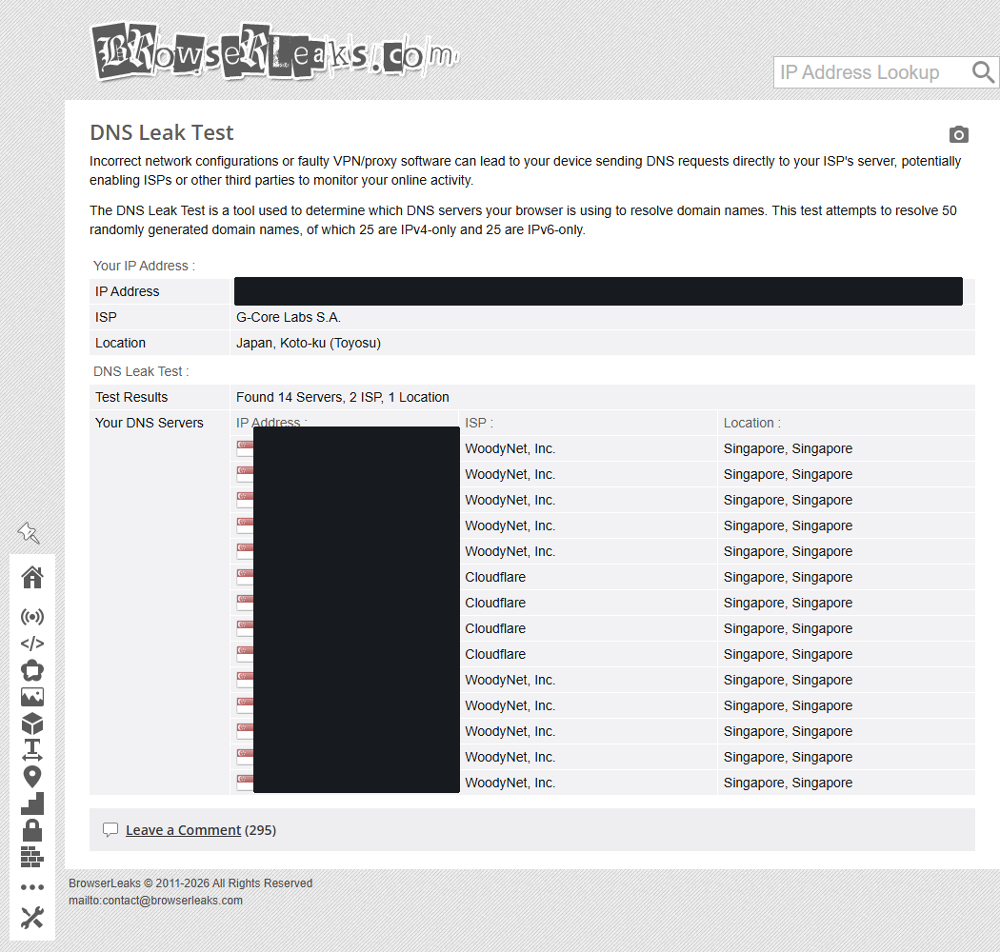

*`/dns`: `Cloudflare`/`WoodyNet` с anycast-PoP в Сингапуре при exit в Токио. Мягкий сигнал, не утечка.*

</details>

## Гигиена скриншотов

- Все IP-адреса, hostname, города, координаты, локальное время и IPv6-адреса замазаны одинаковым способом — тёмными плашками.
- DNS-список в `/dns` и `/ip` сокращён: показаны шапка и несколько строк, полный список из 184 резолверов не нужен для разбора.
- В `/quic` удалена одна строка `JA4_r`: на полноразмерном скриншоте она склеилась с соседней (артефакт full-page capture). Значение `JA4` и HTTP/3-фингерпринт сохранены.
- Антипример снят в headless-режиме, эталон — в обычном браузере. Это часть истории, а не недосмотр: см. [§16](../5-gaps/16-headless.md).

**Подробнее о снимках:** [screenshots/README.md](../../screenshots/README.md).

## Версии и даты

| Что | Версия / состояние |
|---|---|
| Chrome в обоих прогонах | `157.0.8103.79` (UA `157.0.0.0`) |
| Снимки BrowserLeaks | ноябрь 2026 |
| p0f / `p0f.fp` | p0f 3.09b; последнее обновление базы — 2016-05-30 |
| JA4/JA4T | FoxIO-LLC/ja4, репозиторий обновлён 2026-11-17 |
| Satori | xnih/satori, GPL-2.0, обновлён 2026-09-16 |
| Zardaxt | NikolaiT/zardaxt, обновлён 2026-09-21; метрики 94.4% / 0.1% — из README, отдельно не воспроизводились |
| tcpdump (захват SYN) | 4.99.1, Ubuntu 22.04.5, kernel 5.15.0-198 |
| Python в эксперименте | 3.10.12 |
| Дата эксперимента ACK→ClientHello | 2026-11-18 |

Даты репозиториев — по данным GitHub API на 2026-11-18. «Обновлён» — последний push, а не дата релиза: у Satori и Zardaxt релизных тегов может не быть.

---

### Источники

- [BrowserLeaks](https://browserleaks.com/) — все страницы прогонов; [JA4 (FoxIO)](https://github.com/FoxIO-LLC/ja4), [p0f](https://github.com/p0f/p0f), [Satori](https://github.com/xnih/satori), [Zardaxt](https://github.com/NikolaiT/zardaxt).
- [Chrome for Developers: UA-CH](https://developer.chrome.com/docs/privacy-security/user-agent-client-hints/); [RFC 9849 (ECH)](https://www.rfc-editor.org/rfc/rfc9849.html).

---

<sub>[← §10](10-checklist.md) · [Оглавление](../README.md) · [§12. Границы →](12-scope.md)</sub>
