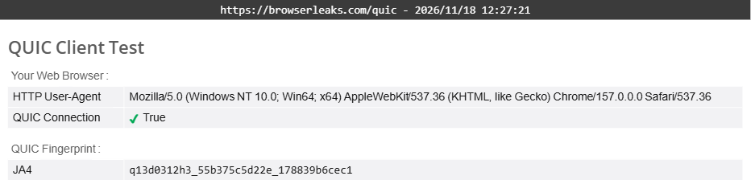
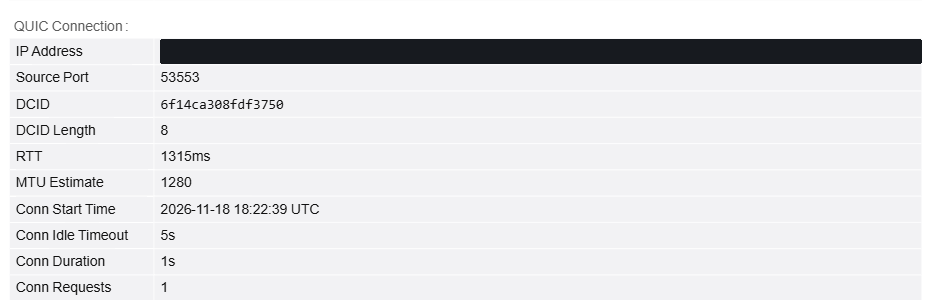

# §15. HTTP/3 и QUIC: второй независимый фингерпринт

[Главная](../../README.md) · [Часть 5](README.md) · [← §14](14-ipv6-dualstack.md) · [§16. Headless →](16-headless.md)

QUIC — это транспорт поверх UDP (RFC 9000), с TLS 1.3 внутри (RFC 9001) и HTTP/3 сверху (RFC 9114). Для детекта он интересен тем, что даёт **второй независимый фингерпринт** и **второй путь утечки**: TCP может идти через прокси, а UDP — мимо.

## Что именно видно

- **JA4 для QUIC.** Тот же формат JA4, но с префиксом `q`: `q13d0312h3_55b375c5d22e_178839b6cec1` — это Chrome 157 (в эталонном прогоне ровно такой). TCP-вариант того же Chrome — `t13d1517h2_…`; сравнивать надо и то, и другое.
- **HTTP/3-фингерпринт.** Порядок и значения SETTINGS, приоритеты, pseudo-header'ы: аналог Akamai-хеша, но для HTTP/3. BrowserLeaks показывает `HTTP3` и `HTTP3 Hash`.
- **QUIC transport parameters.** `initial_max_stream_data_*`, `max_datagram_frame_size`, `max_idle_timeout`, `max_udp_payload_size`, GREASE-значения — набор и значения зависят от реализации. В эталоне: `MTU Estimate 1280`, `RTT 1315 мс`, DCID длиной 8.
- **ECH и SNI.** В QUIC ClientHello тоже есть ECH; в эталоне `ECH Success: False`, outer SNI виден. Даже при включённом ECH наружу уходит `ClientHelloOuter` — JA4 по нему остаётся возможным (RFC 9849).

Сам BrowserLeaks честно пишет: «current JA4 format does not cover all useful signals, such as QUIC Transport Parameters and other QUIC connection artifacts» — то есть JA4Q не покрывает transport parameters, и вендоры, которые хотят копать глубже, смотрят на них отдельно.

## Три состояния сети — три разных исхода

**1. UDP не проходит (типичный прокси).** Браузер откатывается на TCP/HTTP2. Само по себе это не «детект прокси»: QUIC блокируют корпоративные сети, антивирусы и часть операторов. Но если профиль заявляет «домашний гигабит» и Chrome стабильно живёт на HTTP/2 — это расхождение с ожидаемым поведением, мягкий сигнал. Плюс страница грузится медленнее, и это видно по таймингам ([§6](../2-network/06-throughput.md)).

**2. UDP проходит через прокси.** Тогда QUIC-фингерпринт должен совпадать с заявленным Chrome. Если UDP-релей терминирует QUIC и подставляет свой стек — JA4Q выдаст релей. Если релей прозрачный — fingerprint остаётся клиентским, но добавляются задержка и джиттер.

**3. UDP идёт мимо прокси.** Для HTTP-прокси и SOCKS5 без UDP это норма: HTTP/2 идёт через прокси, QUIC — напрямую. (У TUN-VPN наоборот: UDP идёт внутри туннеля.) Худший случай — именно расщепление путей: сайт видит **два разных IP** для одного профиля — ровно как WebRTC-утечка. Это уже жёсткий сигнал.

## Что видно на эталонном прогоне

*`QUIC Connection: True`, `JA4 q13d0312h3_55b375c5d22e_178839b6cec1`, HTTP3-фингерпринт и хеш; RTT `1315 мс` при TCP-RTT `47 мс` ([§5](../2-network/05-rtt.md)), `MTU Estimate 1280`. UDP-путь есть, но он заметно медленнее TCP — ещё один повод не считать «стек совпал» равным «сеть совпала».*

В антипримере QUIC-прогон не снимался, поэтому утверждать «UDP не шёл» мы не будем: absence of evidence — не evidence. Это как раз пример честной границы: если не проверяли — не пишите в выводах.

## Что делать

1. **UDP-релей должен быть.** Проверять `/quic`, а не тариф ([«Провайдеры и шлюзы»](../1-practice/providers-and-gateways.md)).
2. **Сравнивать `JA4 q…` и `JA4 t…`** с одной и той же версией Chrome. Расхождение — признак релея/подмены.
3. **Сравнивать IP из `/quic` с HTTP-IP.** Если BrowserLeaks не показывает IP из QUIC, проверяйте `quic.browserleaks.com` и packet capture на exit.
4. **Помнить про CDN.** HTTP/3 часто терминируется на edge CDN — тогда QUIC-фингерпринт видит CDN, а не бэкенд ([§12](../4-checks/12-scope.md)).
5. **Не «выключать QUIC» для маскировки.** Отключённый QUIC — сам по себе поведенческая аномалия для Chrome, который его поддерживает.

---

### Источники

- RFC 9000 (QUIC transport), RFC 9001 (TLS over QUIC), RFC 9114 (HTTP/3), RFC 9369 (QUIC v2).
- [FoxIO JA4+](https://github.com/FoxIO-LLC/ja4) (пример `q13d0312h3_55b375c5d22e_178839b6cec1`); [BrowserLeaks /quic](https://browserleaks.com/quic), [quic.browserleaks.com](https://quic.browserleaks.com/).
- RFC 9849 (ECH) — объяснение, почему `ClientHelloOuter` остаётся.

---

[← §14](14-ipv6-dualstack.md) · [Оглавление](../README.md) · [§16. Headless →](16-headless.md)
